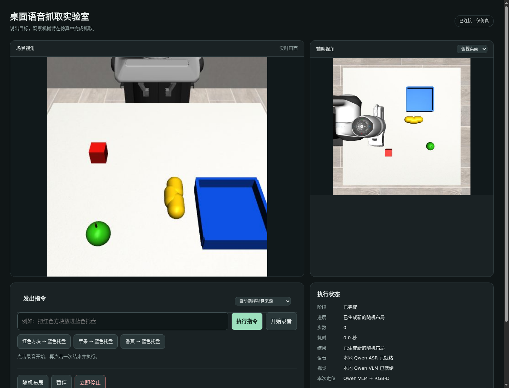

# 桌面语音抓取实验室

独立的本机 MuJoCo / Panda 桌面实验：中文指令 → 目标定位 → 相机 RGB-D 三维位置 → 物理夹爪抓取 → 放进蓝色托盘。项目目录为 `/home/robot/voice-arm-sim`，不连接真机，不修改已有 π0.5 训练工程。

当前物品是红色方块、绿色苹果、黄色香蕉与蓝色托盘。苹果是带茎球体，香蕉由三个胶囊体组合，属于简化几何模型。颜色、形状和初始布局都受限，不能据此声称识别或操纵真实水果。

## 已验证与待验证

| 项目 | 当前证据 |
| --- | --- |
| 颜色 RGB-D 物理抓取 | [`evidence/regression.json`](evidence/regression.json)：seed 42、7、99 × 方块、苹果、香蕉，共 9/9；相机结果与独立真值评分均通过 |
| 指令、投影及目标框契约 | `tests/test_contract.py`：16 项通过，包含拒绝含糊、否定、错误颜色、条件/等待、多目标与选择词等指令且不执行控制步 |
| Qwen 定位的实际抓放 | [苹果文字指令](evidence/text-vlm-apple.json)：433 控制步、22.89 秒、1 次抓取；相机判定已放入托盘 |
| 实际 Web API | [`evidence/api-smoke.json`](evidence/api-smoke.json)：布局变化、未知目标零步、busy 拒绝、暂停/恢复、停止、方块完整执行通过 |
| 视频 | [方块](evidence/cube/demo.mp4)、[苹果](evidence/apple/demo.mp4)、[香蕉](evidence/banana/demo.mp4)（真实物理接触仿真） |
| 本地 ASR / VLM | [8 项实际请求通过](evidence/models/results.json)：官方中文录音、四种目标框、缺失目标与错误输入；四框图已人工查看 |
| 完整语音闭环 | [双视角视频](evidence/voice-vlm/demo.mp4) / [结果](evidence/voice-vlm/result.json)：本地合成中文 WAV → Qwen ASR → Qwen VLM → 物理抓放，433 控制步，23.26 秒全流程，233 帧；真人麦克风未验证 |

**9/9 仅为三个固定物品、三个小幅随机布局的颜色基线回归结果，不是泛化成功率或可靠性承诺。** 仿真控制器使用工程化几何规则和 OSC_POSE，并未训练或运行 π0.5 动作策略；这里产生的录像、轨迹与结果文件也没有被用于微调 π0.5。



## 组件关系

| 组件 | 本项目使用 | 职责 |
| --- | --- | --- |
| 机械臂本体 | Franka Panda | 七关节机械臂与双指夹爪的仿真模型 |
| 仿真与任务环境 | MuJoCo + robosuite | 物理接触、相机、深度与桌面场景 |
| 语音识别 | Qwen3-ASR-0.6B | 中文录音转文字 |
| 视觉语言模型 | Qwen3-VL-4B-Instruct | 按指令找物体的二维框 |
| 定位与执行 | RGB-D 反投影 + OSC_POSE | 三维位置、分阶段抓放、空抓后有限重试 |
| 界面 | 本机中文网页 | 录音、文字指令、视角、暂停、停止与重置 |

π0.5 是动作策略模型，与机械臂本体和仿真平台属于不同组件。本原型首先验证模块化链路，当前是单条抓放命令交互；自由多轮对话、表情屏幕、对话记忆、持续学习和任意物品抓取尚未实现。

## 独立环境准备

以下命令均在新项目内执行。需要已有 `uv`、Python 3.11 和可用的本机 OpenGL/EGL 驱动；本机已验证 MuJoCo 3.2.3、robosuite 1.4.1 与 NumPy 1.26.4。依赖版本见两个 requirements 文件。

```bash
cd /home/robot/voice-arm-sim
rtk proxy uv venv --python 3.11 .venv
rtk proxy uv pip install --python .venv/bin/python -r requirements.txt
```

若只运行文字命令与颜色 RGB-D 基线，不需要下载语音和视觉模型。需要本地模型时：

```bash
rtk proxy bash scripts/setup_models.sh
```

模型使用独立 `.venv-models` 与项目内 `models/`，包括 Qwen3-ASR-0.6B、Qwen3-VL-4B-Instruct。下载会占用网络和磁盘；加载会占用 GPU。模型服务要求 CUDA；本机 RTX 5090 D 已通过真实 GPU 运算及 ASR/VLM 推理。RTX 5090 D 需要实际支持该架构的 CUDA 构建；本项目指定官方 PyTorch `2.7.1+cu128`，不以 `cuda.is_available()` 代替运算验证。权重固定到 ASR `5eb144179a02acc5e5ba31e748d22b0cf3e303b0` 与 VL `ebb281ec70b05090aa6165b016eac8ec08e71b17`，下载后核对完整文件 SHA256。包清单与上游模型 revision 记录在 [manifest](evidence/models/manifest.json)，实际算子证据为 [cuda-check](evidence/models/cuda-check.json)。独立模型环境的 114 包版本固定在 `requirements-models-lock.txt`。

## 启动与操作

```bash
cd /home/robot/voice-arm-sim
rtk proxy bash scripts/launch.sh
# 仅启动文字 + 颜色基线：
rtk proxy env START_MODELS=0 bash scripts/launch.sh
```

浏览器打开 **http://127.0.0.1:8910**。模型服务在 **http://127.0.0.1:8911**，健康状态路径为 `/health`。启动脚本在存在模型环境时按需后台启动模型，等待最多 180 秒；未就绪仍可启动文字与颜色基线。模型就绪可能晚于网页启动。日志为 `logs/app.log`、`logs/models.log`。8910 已在运行时请复用现有服务，不要重复启动。

网页提供场景、俯视与腕部画面，文字输入、快捷指令、随机布局、暂停/继续与立即停止。执行过程按约 20 Hz 墙钟节奏显示；离线评测可运行得更快，因此离线日志耗时不等于 Web 交互耗时。支持示例：

- 把红色方块放进蓝色托盘。
- 把苹果放进蓝色托盘。
- 把香蕉放进蓝色托盘。

视觉模式在空闲时切换：

| 模式 | 行为 |
| --- | --- |
| `color` | 已知颜色和物品词表，RGB-D 基线定位；未知指令需澄清 |
| `vlm` | 本地 Qwen 给出目标框，再用深度反投影；模型未就绪、空框或推理错误会明确报错 |
| `auto` | 每条执行开始时检查健康状态；VLM 可用则使用 VLM，否则明确选择颜色基线；VLM 推理失败不静默回退 |

页面“本次定位”显示实际来源。VLM 的目标框仍需符合几何前景检查，不能把托盘作为被抓物体；仅框出物体不代表成功抓取。

麦克风需浏览器支持 `getUserMedia` 和 `AudioContext`。在 `localhost` 或 `127.0.0.1` 页面允许麦克风权限：点一次开始，第二次结束并发送 WAV，识别成功后自动执行一次。最长录音 30 秒。无设备、权限拒绝、短录音或模型失败会显示错误；可以使用文字输入。通过普通局域网 HTTP 地址打开通常不能使用麦克风，且服务仅绑定本机。

## 复跑验证与录像

先安装独立测试工具：

```bash
rtk proxy uv pip install --python .venv/bin/python pytest
rtk proxy .venv/bin/python -m pytest -q tests/test_contract.py
rtk proxy .venv/bin/python smoke.py --output runs/scene-check
```

以下物理评测/录像启动自己的仿真实例，输出目录必须选择新的名称；不要与其它控制实验争用算力。`evaluate.py` 会拒绝覆盖已有结果文件，`demo.py` 会拒绝覆盖已有输出目录。

```bash
rtk proxy .venv/bin/python evaluate.py --output runs/regression-new.json
rtk proxy .venv/bin/python demo.py --seed 42 --command '把红色方块放进蓝色托盘' --output runs/demo-cube-new
```

录像目录包含 `demo.mp4`、`trace.json`、`result.json`，轨迹记录末端位置、夹爪状态和阶段。实际 HTTP 测试需要 8910 服务在运行，会操作网页同一仿真，测试期间不要并行下指令；结束自动恢复 seed 42：

```bash
rtk proxy .venv/bin/python scripts/api_smoke.py
```

模型真实推理测试需要先启动 8911；脚本可等待就绪最多 600 秒，测试官方中文样例、已知/缺失目标及错误请求，并写入 `runs/models-smoke/results.json` 和框图：

```bash
rtk proxy .venv-models/bin/python model_service.py
# 在另一个终端：
rtk proxy .venv-models/bin/python scripts/model_smoke.py
# 或提供自己的中文 WAV：
rtk proxy .venv-models/bin/python scripts/model_smoke.py --audio /absolute/path/command.wav
```

本机已运行该测试并查看四张框图，定位到正确的方块、苹果、香蕉与托盘；缺失的紫色恐龙返回空框。此项只证明单张桌面图的定位与官方录音的识别，完整录音→执行链另行记录。

完整 WAV → 语音识别 → 视觉定位 → 抓放验收与双视角录像：

```bash
rtk proxy .venv/bin/python scripts/voice_e2e.py --audio /absolute/path/command.wav --mode vlm --seed 42 --output runs/voice-new
```

该测试会操作同一网页仿真，请在空闲时执行；失败也保存状态轨迹和录像。不能代替真人麦克风验收。

本机清晰测试语音来自可选的本地 CPU Piper 神经合成工具，独立于应用和模型服务：

```bash
rtk proxy uv venv --python 3.11 .venv-tts
rtk proxy uv pip install --python .venv-tts/bin/python -r requirements-tts.txt
rtk proxy .venv-tts/bin/python scripts/synthesize_neural_command.py --text '请把绿色苹果放到蓝色托盘里面。' --output runs/command-new.wav --transcribe
```

Piper 引擎 GPL-3.0；上游 huayan 声音卡将数据集许可标为 Unknown，仅用于本地测试，声音权重和音频不随本仓库分发，也不是未来玩具产品的运行依赖。音频来源与识别响应记录在证据 JSON 中；公开抓放视频不含合成语音音轨。最初的 eSpeak 及短句同音识别问题也保留，不能把一条清晰样例当成语音准确率。

## 相机、动作与评分边界

定位从相机 RGB、深度、内参与外参反投影得到世界坐标；控制器不读物体 `body_xpos` 来规划。相机图像/深度同时上下翻转，保持像素对应。机械臂先移开顶部相机遮挡，接触后重试使用新图像，空抓最多重试一次。抓取依靠夹爪接触、摩擦和仿真物理，没有瞬移、焊接或强行附着。

`evaluation_truth()` 仅供 `smoke.py` 的调试记录、`demo.py` 与 `evaluate.py` 的独立评分。相机判定和真值评分分别记录；真值不反馈进抓取规划。真值托盘评分检查目标中心的平面范围及高度，并不等价于真实机器人上的稳定性证明。

已处理的主要问题及证据：

- 渲染分组：robosuite 的碰撞/质量几何与可见几何分组不同。保留 group 0 物理几何，增加 group 1、零质量且无碰撞的视觉副本，避免物体不可见并保持质量定义；见 `scene.py` 与场景截图。
- 几何与接触：早期苹果/香蕉下降阶段超时，失败记录保留在 `runs/physical-apple-v1`、`runs/physical-banana-v1`、`runs/physical-banana-v2`。调整简化物体几何、接触摩擦、初始可达布局和抓取高度/容差后，以三个种子 × 三物体重新验证；最终依据是 [9 项回归记录](evidence/regression.json)，不是只看单条成功录像。
- GPU：旧 `2.7.1+cu126` 虽然返回 CUDA 可用，RTX 5090 D 实际算子仍报架构不支持；独立换用官方 `2.7.1+cu128` 后真实矩阵运算与模型推理通过。下载出现 Xet 尾段停滞，以官方 Range 响应修复并核对完整权重 SHA256，未修改旧环境。
- 语音输入：eSpeak 普通话样本被识别成错误文字，程序要求澄清且控制步为 0；[失败记录](evidence/voice-espeak-failure/result.json)保留，不能用官方非指令录音成功掩盖此项。
- 依赖：初次安装选中新版 SciPy/LLVM 并在下载阶段停滞；本项目固定 SciPy 1.15.3、Numba 0.61.2、llvmlite 0.44.0 等版本，使用独立环境。没有改旧训练环境。
- 服务与渲染线程：GL 和全部 `env.step()` 归仿真 worker 所有；HTTP 读取 JPEG/状态缓存，避免不同请求线程争用上下文。停止/暂停在控制步边界检查。

## 上游项目与模型

- [MuJoCo Python 文档](https://mujoco.readthedocs.io/en/stable/python.html)
- [robosuite](https://github.com/ARISE-Initiative/robosuite)
- [Piper 本地测试语音引擎](https://github.com/OHF-Voice/piper1-gpl) / [huayan 声音卡](https://huggingface.co/rhasspy/piper-voices/blob/5041a7a49ae5b3a0f30e6837769eb03fdbb231bd/zh/zh_CN/huayan/medium/MODEL_CARD)
- [Qwen3-ASR](https://github.com/QwenLM/Qwen3-ASR) / [Qwen3-ASR-0.6B 模型](https://huggingface.co/Qwen/Qwen3-ASR-0.6B)
- [Qwen3-VL](https://github.com/QwenLM/Qwen3-VL) / [Qwen3-VL-4B-Instruct 模型](https://huggingface.co/Qwen/Qwen3-VL-4B-Instruct)

Panda 资产来自已固定版本的 robosuite。本项目未依赖 MuJoCo Menagerie，也未重新分发任何 π0.5 训练数据。
