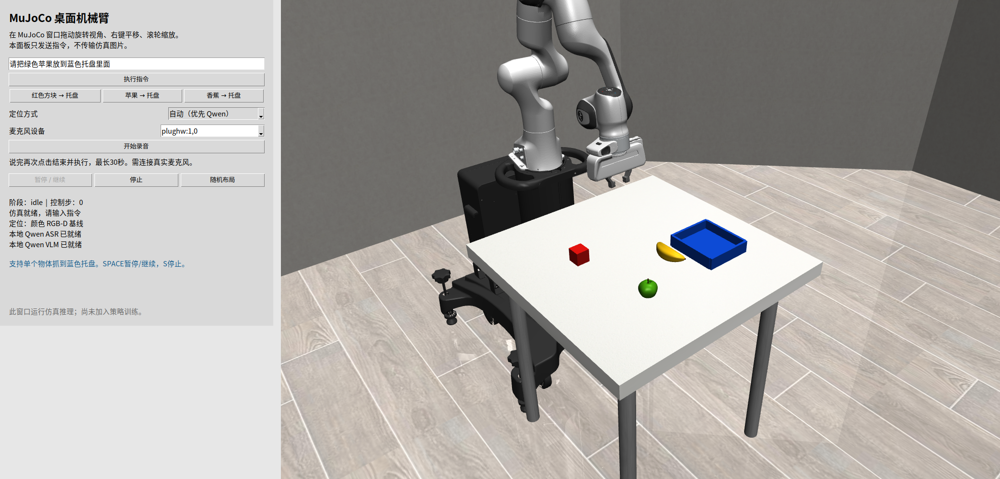

# 桌面语音抓取实验室

新增 **[带历史和前置规划的持续恢复](evidence/continuous-recovery-20261025/README.md)**：模型比较行动前后画面，能发现抽屉未开并补做前置动作，核验后继续原目标；空抓和持物中断恢复、不重置的连续指令均有实际仿真记录。原来固定两次的恢复预算改为进展与停滞判断，同时保留动作/时间保护上限。使用 Qwen3-VL＋RGB-D/OSC，没有新增训练；固定场景功能验收不代表通用可靠性。

**最新复测限制**：抽屉仍不稳定。原生面板自动打开并放入成功，关闭阶段把手定位未通过几何检查，整条指令未确认完成；另一次放置接触后未能恢复。成功、失败和停止原因均见上述报告。

新增 **[连续抽屉任务与实际自动恢复](evidence/recovery-drawer-20261025/README.md)**：已在原生中文面板实际完成“打开底层抽屉 → 奶酪盒放入 → 关闭”，逐步核验后自动停止、保留现场。[三步录像](evidence/recovery-drawer-20261025/sequence/demo.mp4)。空抓后模型选择重抓、持物中断后模型选择续放，两种恢复均实际执行成功；抽屉完成核验加入相机深度位移以拦截视觉误判。这是 Qwen3-VL＋RGB-D/OSC，没有新增训练。当前只验收固定布局底层抽屉和两类受控故障，不代表任意物品或通用恢复。

上一版 **[中文完整指令分解与逐步核验](evidence/chinese-task-plan-20261025/README.md)** 保留：曾实际连续完成“酒瓶先放柜顶，再放灶台”；当时抽屉尚不支持、恢复仅给建议。这两项缺口已由上述新版本补齐，旧报告描述的是历史状态。独立 VLA 入口位于“VLA 调试”标签页。

当前中文面板采用 **[视觉定位＋通用抓放控制](evidence/visual-control-20261025/README.md)**：已从保留的失败现场实际连续执行“酒瓶到柜子 → 到灶台 → 到碗内”，三条之间不重置，逐条松爪、撤手、停止。此次按用户选择使用 Qwen3-VL 理解指令、RGB-D 定位和 OSC 控制；不是 π0.5 动作预测，也没有新增训练。旧 VLA 调试入口仍独立保留；适用范围与失败证据见报告。

历史混合控制版本见 **[中文视觉抓放：实测、演示与失败边界](evidence/visual-semantic-20261025/README.md)**：在旧版面板点击“视觉理解抓放”，由 Qwen3-VL 根据当前图像选择源物体和目的地，π0.5 抓取、RGB-D／OSC 搬运与松爪。本轮没有新增训练；酒瓶进碗、酒瓶上盘、碗上盘已有实际执行证据，木架放置和从碗里取出酒瓶仍失败。这是混合控制实验，尚不能代表任意家庭物品抓放。

新增的真正 VLA 入口见 **[π0.5 多任务 MuJoCo 演示](vla/README.md)**：双摄像头、机械臂状态与指令直接输入官方 π0.5 LIBERO 权重，模型输出连续动作。以下水果实验保留为模块化几何控制基线，证据不能与 VLA 混算。

新增 [同场景改指令的实际 LoRA 训练与对比](evidence/language-guidance/DISTILLATION.md)：V2 已完成累计 10000 次更新及 24 次纯模型评测，视觉复核酒瓶入碗 4/8、酒瓶入架 8/8、碗上盘 8/8。[同布局不同中文指令录像](https://github.com/sencangWei/voice-arm-sim/releases/download/language-distillation-v1/same-scene-chinese-instructions-v2.mp4)展示模型改变目的地；[原模型与 V2 对比](https://github.com/sencangWei/voice-arm-sim/releases/download/language-distillation-v1/baseline-vs-trained-v2-init009.mp4)展示单例。评测直接执行模型动作；合成教师来源与失败公开。仍未达到稳定入碗要求，不能代表开放家庭指令理解。

另有独立的 [MolmoAct2 接入与同场景测试](vla/MOLMOACT2.md)，复用原生中文工作台；实际测试结果单独记录。

新增 [HAMSTER 中文分层抓放实验](evidence/hamster/physical-hybrid/REPORT.md)与[同场景前后对比录像](evidence/hamster/physical-hybrid/hybrid-comparison-01/bottle-bowl-before-after.mp4)：实际模型选目标，π0.5 抓取，RGB-D／OSC 搬运和松爪。固定布局、混合控制，未宣称端到端 VLA 或任意家居物品泛化。

[实际 VLA Demo](evidence/vla/demo.mp4) / [实测报告与复现命令](evidence/vla/README.md)：放碗、开抽屉、奶酪入篮共5次执行通过所选任务判据；当前为官方预训练权重推理，尚未验证任意水果和真人麦克风。

独立的本机 MuJoCo / Panda 桌面实验：中文指令 → 目标定位 → 相机 RGB-D 三维位置 → 物理夹爪抓取 → 放进蓝色托盘，或从盘子取出放到桌面空位。项目目录为 `/home/robot/voice-arm-sim`，不连接真机，不修改已有 π0.5 训练工程。

当前物品是红色方块、绿色苹果、黄色香蕉与蓝色托盘。苹果与香蕉使用程序生成的连续视觉网格，碰撞仍用球体/胶囊近似，属于简化模型。颜色、形状和初始布局都受限，不能据此声称识别或操纵真实水果。

## 已验证与待验证

| 项目 | 当前证据 |
| --- | --- |
| 颜色 RGB-D 物理抓取 | [`evidence/regression.json`](evidence/regression.json)：seed 42、7、99 × 方块、苹果、香蕉，共 9/9；相机结果与独立真值评分均通过 |
| 指令、投影及目标框契约 | `tests/`：30 项通过（含原生初始化失败退出、取出语义与桌面空位），拒绝含糊、否定、错误颜色、条件/等待、多目标与未支持的取出目的地 |
| 从盘子取出 | [颜色物理回归](evidence/takeout/color-results.json)：三个种子 × 三物品，9/9 对“放进→取出”均通过相机与独立真值评分；是固定场景回归 |
| 原生窗口取出操作 | [实际按钮与 Qwen 执行记录](evidence/takeout/native-result.json) / [录像](evidence/takeout/native-demo.mp4)：先放入香蕉，再点击取出按钮，取出359控制步、19.62秒 |
| Qwen 定位的实际抓放 | [苹果文字指令](evidence/text-vlm-apple.json)：433 控制步、22.89 秒、1 次抓取；相机判定已放入托盘 |
| 实际 Web API | [`evidence/api-smoke.json`](evidence/api-smoke.json)：布局变化、未知目标零步、busy 拒绝、暂停/恢复、停止、方块完整执行通过 |
| 视频 | [方块](evidence/cube/demo.mp4)、[苹果](evidence/apple/demo.mp4)、[香蕉](evidence/banana/demo.mp4)（真实物理接触仿真） |
| 本地 ASR / VLM | [8 项实际请求通过](evidence/models/results.json)：官方中文录音、四种目标框、缺失目标与错误输入；四框图已人工查看 |
| 完整语音闭环 | [双视角视频](evidence/voice-vlm/demo.mp4) / [结果](evidence/voice-vlm/result.json)：本地合成中文 WAV → Qwen ASR → Qwen VLM → 物理抓放，433 控制步，23.26 秒全流程，233 帧；真人麦克风未验证 |

**9/9 仅为三个固定物品、三个小幅随机布局的颜色基线回归结果，不是泛化成功率或可靠性承诺。** 以下水果基线控制器使用工程化几何规则和 OSC_POSE；其录像、轨迹与结果没有被用于微调 π0.5。新增 `vla/` 独立入口运行官方 π0.5 动作策略，证据单独保存。



原生版的合成中文语音抓苹果全流程用时23.69秒，434控制步；真人麦克风仍待验证。原生版验证见 [交互记录](evidence/native/interaction.json)、[水果回归](evidence/native/regression.json)、[原生录屏](evidence/native/demo.mp4)和[语音执行结果](evidence/native/voice-result.json)。旧网页证据保留在原路径。

## 组件关系

| 组件 | 本项目使用 | 职责 |
| --- | --- | --- |
| 机械臂本体 | Franka Panda | 七关节机械臂与双指夹爪的仿真模型 |
| 仿真与任务环境 | MuJoCo + robosuite | 物理接触、相机、深度与桌面场景 |
| 语音识别 | Qwen3-ASR-0.6B | 中文录音转文字 |
| 视觉语言模型 | Qwen3-VL-4B-Instruct | 按指令找物体的二维框 |
| 定位与执行 | RGB-D 反投影 + OSC_POSE | 三维位置、分阶段抓放、空抓后有限重试 |
| 界面 | MuJoCo 原生窗口 + 中文 Tk 面板 | 鼠标自由视角、录音、文字指令、暂停、停止与重置 |

π0.5 是动作策略模型，与机械臂本体和仿真平台属于不同组件。本原型首先验证模块化链路，当前是单条抓放命令交互；自由多轮对话、表情屏幕、对话记忆、持续学习和任意物品抓取尚未实现。

## 独立环境准备

以下命令均在新项目内执行。需要已有 `uv`、Python 3.11 和可用的本机 OpenGL/EGL 驱动；原生桌面使用 Ubuntu 的 `/usr/bin/python3` + Tk（`python3-tk`）、中文字体和 ALSA `arecord`，本机均已具备；本机已验证 MuJoCo 3.2.3、robosuite 1.4.1 与 NumPy 1.26.4。依赖版本见两个 requirements 文件。

```bash
cd /home/robot/voice-arm-sim
rtk proxy uv venv --python 3.11 .venv
rtk proxy uv pip install --python .venv/bin/python -r requirements.txt
```

若只运行文字命令与颜色 RGB-D 基线，不需要下载语音和视觉模型。需要本地模型时：

```bash
rtk proxy bash scripts/setup_models.sh
```

模型使用独立 `.venv-models` 与项目内 `models/`，包括 Qwen3-ASR-0.6B、Qwen3-VL-4B-Instruct。下载会占用网络和磁盘；加载会占用 GPU。模型服务要求 CUDA；本机 RTX 5090 D 已通过真实 GPU 运算及 ASR/VLM 推理。RTX 5090 D 需要实际支持该架构的 CUDA 构建；本项目指定官方 PyTorch `2.7.1+cu128`，不以 `cuda.is_available()` 代替运算验证。权重固定到 ASR `5eb144179a02acc5e5ba31e748d22b0cf3e303b0` 与 VL `ebb281ec70b05090aa6165b016eac8ec08e71b17`，下载后核对完整文件 SHA256。包清单与上游模型 revision 记录在 [manifest](evidence/models/manifest.json)，实际算子证据为 [cuda-check](evidence/models/cuda-check.json)。独立模型环境的 114 包版本固定在 `requirements-models-lock.txt`。

## 启动与操作

```bash
cd /home/robot/voice-arm-sim
rtk proxy bash scripts/launch.sh
# 仅启动文字 + 颜色基线：
rtk proxy env START_MODELS=0 bash scripts/launch.sh
```

默认打开 **MuJoCo 原生窗口和中文桌面控制面板**，不需要浏览器。MuJoCo 负责实时物理与显示，面板只传指令与状态，不传输三路 JPEG。端口 8910 仍是本机控制接口，8911 是本地模型服务（`/health`）。日志为 `logs/app.log`、`logs/models.log`；若 8910 已运行，请使用现有窗口，避免重复启动。

- 在 MuJoCo 画面中**左键拖动旋转、右键拖动平移、滚轮缩放**；空闲和暂停时均可操作。
- 在中文面板输入指令或点快捷按钮；运行中可暂停、继续和停止。MuJoCo 窗口中 `SPACE` 暂停/继续、`S` 停止。
- “随机布局”重新摆放物品；关闭任一窗口会结束该仿真实例，模型服务独立保留。
- 面板选择 ALSA 麦克风设备，点“开始录音”，说完再次点按钮发送，最长 30 秒。当前只检测到模拟音频采集设备，**真人麦克风信号尚未验收**；语音链路用本地合成 WAV 验证。

启动脚本在存在模型环境时按需启动本地模型并等待最多180秒，未就绪可用文字和颜色基线。交互控制目标20Hz；VLM请求和机器负载仍可能增加墙钟耗时。支持示例：

- 把红色方块放进蓝色托盘。
- 把苹果放进蓝色托盘。
- 把香蕉放进蓝色托盘。
- 把香蕉从盘子里面取出来。
- 把苹果从蓝色托盘拿出来放在桌上。

“取出来”默认放到相机确认的桌面空位，面板也提供香蕉取出按钮。抓取前检查目标位于盘子内，并通过深度图确认放置区域是可见桌面、远离托盘和其它凸起物；无空位或目标不在盘子里时会说明原因并停止任务。当前仅支持单个物体放进托盘或从托盘取到桌面，不支持取出后放入抽屉、指定任意左右位置、连续复合任务。新动作是补齐指令解析与几何控制流程，没有重新训练模型。

视觉模式在空闲时切换：

| 模式 | 行为 |
| --- | --- |
| `color` | 已知颜色和物品词表，RGB-D 基线定位；未知指令需澄清 |
| `vlm` | 本地 Qwen 给出目标框，再用深度反投影；模型未就绪、空框或推理错误会明确报错 |
| `auto` | 每条执行开始时检查健康状态；VLM 可用则使用 VLM，否则明确选择颜色基线；VLM 推理失败不静默回退 |

面板“定位”显示实际来源。VLM 的目标框仍需符合几何前景检查，不能把托盘作为被抓物体；仅框出物体不代表成功抓取。

备用网页仅供兼容旧接口/三相机录像脚本：

```bash
rtk proxy bash scripts/launch.sh --web
```

网页视图是固定相机画面，不能拖动旋转。原生模式不提供 `/api/frame` 图片流。切换入口前关闭现有实例，避免占用同一端口。

## 复跑验证与录像

先安装独立测试工具：

```bash
rtk proxy uv pip install --python .venv/bin/python pytest
rtk proxy .venv/bin/python -m pytest -q tests/
rtk proxy .venv/bin/python smoke.py --output runs/scene-check
```

以下物理评测/录像启动自己的仿真实例，输出目录必须选择新的名称；不要与其它控制实验争用算力。`evaluate.py` 会拒绝覆盖已有结果文件，`demo.py` 会拒绝覆盖已有输出目录。

```bash
rtk proxy .venv/bin/python evaluate.py --output runs/regression-new.json
rtk proxy .venv/bin/python evaluate_takeout.py --output runs/takeout-new
rtk proxy .venv/bin/python demo.py --seed 42 --command '把红色方块放进蓝色托盘' --output runs/demo-cube-new
```

录像目录包含 `demo.mp4`、`trace.json`、`result.json`，轨迹记录末端位置、夹爪状态和阶段。旧版实际 HTTP 测试需要 `--web` 入口在运行（含图片流检查），会操作同一仿真，测试期间不要并行下指令；结束自动恢复 seed 42：

```bash
rtk proxy .venv/bin/python scripts/api_smoke.py
```

模型真实推理测试需要先启动 8911；脚本可等待就绪最多 600 秒，测试官方中文样例、已知/缺失目标及错误请求，并写入 `runs/models-smoke/results.json` 和框图：

```bash
rtk proxy .venv-models/bin/python model_service.py
# 在另一个终端：
rtk proxy .venv-models/bin/python scripts/model_smoke.py
# 或提供自己的中文 WAV：
rtk proxy .venv-models/bin/python scripts/model_smoke.py --audio /absolute/path/command.wav
```

本机已运行该测试并查看四张框图，定位到正确的方块、苹果、香蕉与托盘；缺失的紫色恐龙返回空框。此项只证明单张桌面图的定位与官方录音的识别，完整录音→执行链另行记录。

完整 WAV → 语音识别 → 视觉定位 → 抓放验收与双视角录像：

```bash
rtk proxy .venv/bin/python scripts/voice_e2e.py --audio /absolute/path/command.wav --mode vlm --seed 42 --output runs/voice-new
```

该测试要求 `--web` 入口，并会操作同一仿真，请在空闲时执行；失败也保存状态轨迹和录像。不能代替真人麦克风验收。

本机清晰测试语音来自可选的本地 CPU Piper 神经合成工具，独立于应用和模型服务：

```bash
rtk proxy uv venv --python 3.11 .venv-tts
rtk proxy uv pip install --python .venv-tts/bin/python -r requirements-tts.txt
rtk proxy .venv-tts/bin/python scripts/synthesize_neural_command.py --text '请把绿色苹果放到蓝色托盘里面。' --output runs/command-new.wav --transcribe
```

Piper 引擎 GPL-3.0；上游 huayan 声音卡将数据集许可标为 Unknown，仅用于本地测试，声音权重和音频不随本仓库分发，也不是未来玩具产品的运行依赖。音频来源与识别响应记录在证据 JSON 中；公开抓放视频不含合成语音音轨。最初的 eSpeak 及短句同音识别问题也保留，不能把一条清晰样例当成语音准确率。

## 相机、动作与评分边界

定位从相机 RGB、深度、内参与外参反投影得到世界坐标；控制器不读物体 `body_xpos` 来规划。相机图像/深度同时上下翻转，保持像素对应。机械臂先移开顶部相机遮挡，接触后重试使用新图像，空抓最多重试一次。抓取依靠夹爪接触、摩擦和仿真物理，没有瞬移、焊接或强行附着。

`evaluation_truth()` 仅供 `smoke.py` 的调试记录、`demo.py`、`evaluate.py` 与 `evaluate_takeout.py` 的独立评分。相机判定和真值评分分别记录；真值不反馈进抓取规划。真值托盘评分检查目标中心的平面范围及高度，并不等价于真实机器人上的稳定性证明。

已处理的主要问题及证据：

- 取出指令：原版本把“把香蕉从盘子里面取出来”拒绝为澄清，运行0步；控制器也只实现放进托盘。现增加独立取出分支，抓取前从RGB-D确认桌面空位，移出后张开夹爪并检查结果。不是模型卡住或训练不足；新物理评测会先真实放入，再真实取出，禁止直接改物体位置。
- 原生入口：旧网页只展示固定截图，每3个控制步渲染三个视角并编码传图。现默认使用 MuJoCo passive viewer，GUI 与物理线程经 `sync()` 同步，RGB-D 仅在感知需要时获取。相机转动不改变策略观测相机。水果视觉网格与物理碰撞分离，修改后质量/惯量/重心逐位相同，九项回归全部通过；不代表照片级建模或任意物品泛化。
- 渲染分组：robosuite 的碰撞/质量几何与可见几何分组不同。保留 group 0 物理几何，增加 group 1、零质量且无碰撞的视觉副本，避免物体不可见并保持质量定义；见 `scene.py` 与场景截图。
- 几何与接触：早期苹果/香蕉下降阶段超时，失败记录保留在 `runs/physical-apple-v1`、`runs/physical-banana-v1`、`runs/physical-banana-v2`。调整简化物体几何、接触摩擦、初始可达布局和抓取高度/容差后，以三个种子 × 三物体重新验证；最终依据是 [9 项回归记录](evidence/regression.json)，不是只看单条成功录像。
- GPU：旧 `2.7.1+cu126` 虽然返回 CUDA 可用，RTX 5090 D 实际算子仍报架构不支持；独立换用官方 `2.7.1+cu128` 后真实矩阵运算与模型推理通过。下载出现 Xet 尾段停滞，以官方 Range 响应修复并核对完整权重 SHA256，未修改旧环境。
- 语音输入：eSpeak 普通话样本被识别成错误文字，程序要求澄清且控制步为 0；[失败记录](evidence/voice-espeak-failure/result.json)保留，不能用官方非指令录音成功掩盖此项。
- 依赖：初次安装选中新版 SciPy/LLVM 并在下载阶段停滞；本项目固定 SciPy 1.15.3、Numba 0.61.2、llvmlite 0.44.0 等版本，使用独立环境。没有改旧训练环境。
- 服务与渲染线程：GL 和全部 `env.step()` 归仿真 worker 所有；HTTP 读取 JPEG/状态缓存，避免不同请求线程争用上下文。停止/暂停在控制步边界检查。

## 上游项目与模型

- [MuJoCo Python 文档](https://mujoco.readthedocs.io/en/stable/python.html)
- [robosuite](https://github.com/ARISE-Initiative/robosuite)
- [Piper 本地测试语音引擎](https://github.com/OHF-Voice/piper1-gpl) / [huayan 声音卡](https://huggingface.co/rhasspy/piper-voices/blob/5041a7a49ae5b3a0f30e6837769eb03fdbb231bd/zh/zh_CN/huayan/medium/MODEL_CARD)
- [Qwen3-ASR](https://github.com/QwenLM/Qwen3-ASR) / [Qwen3-ASR-0.6B 模型](https://huggingface.co/Qwen/Qwen3-ASR-0.6B)
- [Qwen3-VL](https://github.com/QwenLM/Qwen3-VL) / [Qwen3-VL-4B-Instruct 模型](https://huggingface.co/Qwen/Qwen3-VL-4B-Instruct)

Panda 资产来自已固定版本的 robosuite。本项目未依赖 MuJoCo Menagerie，也未重新分发任何 π0.5 训练数据。

## 备份与恢复核对

代码、锁定依赖、测试结果与 Demo 已推送至公开仓库 [sencangWei/voice-arm-sim](https://github.com/sencangWei/voice-arm-sim/tree/prototype/voice-tabletop)，分支 `prototype/voice-tabletop`。能力提交 `355d6f1` 已从 GitHub 克隆到独立目录，54 个文件的 SHA256 与 Git tree 全部一致，详见[恢复核对记录](evidence/backup-capability.json)。模型权重、虚拟环境和语音样本不在仓库内，按本文命令单独准备。

原生窗口与水果改版已备份为能力提交 `6014a80`；独立从 GitHub 克隆后，67个跟踪文件 SHA256 和 Git tree 全部一致，见[原生版恢复记录](evidence/native/backup-capability.json)。

取出动作修复已备份为能力提交 `608cc1a`，代码、9组物理回归、实际面板与仿真并列 Demo 均已从 GitHub 独立恢复，74个跟踪文件 SHA256 和 Git tree 全部匹配，见[取出版恢复记录](evidence/takeout/backup-capability.json)。
