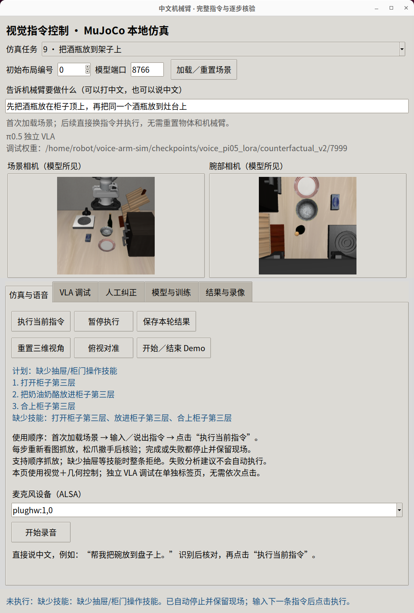
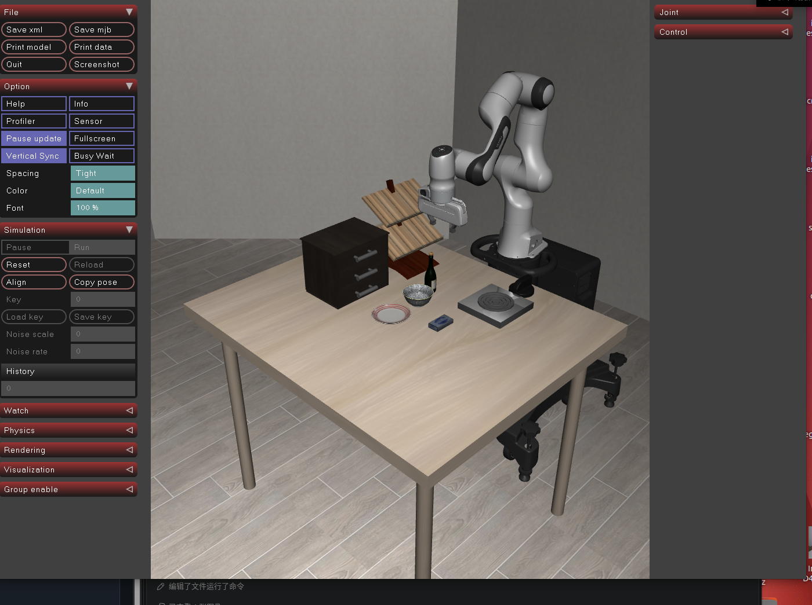

# 中文完整指令：从开源学习到实际执行

2026-10-25。本轮在原生中文 Tk＋MuJoCo 工作台落地完整指令分解、能力检查、顺序抓放与逐步核验。没有训练或修改 π0.5 权重，没有连接真机。

## 学到的内容及对应改动

上游源码、版本、逐文件哈希和阅读结论见[前一轮学习报告](../task-decomposition-study-20261025/README.md)与[source-manifest.json](../task-decomposition-study-20261025/source-manifest.json)。这里借鉴架构，未宣称成功运行上游真机工程或复现视频全部能力。

| 来源 | 本轮采用的思路 | 本地实现 |
| --- | --- | --- |
| VectorRobotics/vector-os-nano | 先做完整计划与技能检查，再执行，反馈执行结果 | `/plan` 和 `vla/task_runner.py`；缺少技能整条拒绝 |
| TommyZihao/vlm_arm | 中文语言分解与视觉定位分工 | 语言先分步骤，每步开始再用当前图像选择对象和目的地 |
| renyimen2026/wheelarm-lab | 明确的有序任务与执行状态 | 只在上一步核验通过后前进，暂停与失败都保留现场 |

旧的单个 source/destination/relation 对象不能保存“打开→放入→关闭”这样的完整请求。现在模型必须返回有界 JSON 计划，最多八步；只接受列出的技能和目的地类型，不执行模型生成的代码或坐标。抽屉技能仍然缺失，所以完整展示后拒绝，不再把“放进抽屉”误当成碗内抓放。

初始规划只把语言送入 Qwen3-VL，避免模型因后续步骤的目的地尚未形成而拒绝整个计划。请求仍保存当时图像及 SHA256；`model_input_image_sha256: []` 明确记录初始规划没有用图。每个实际抓放步骤都会重新送入当前图像。单步关系必须与完整计划的目的地类型一致，否则在动作前报错。执行失败后一次性回传当前图像和失败日志，保存建议，`executed: false`，没有自动恢复动作。

## 实际验证

独立 MuJoCo 实例从前一轮保留的失败现场重放初始化，LIBERO goal 任务 9、seed 7。控制器使用真实相机 RGB-D 与 OSC，不接收对象真值。独立物理评分仅在每步完成后读取对象关系和夹爪接触，不参与控制。

| 输入 | 实测结果 |
| --- | --- |
| 打开柜子第三层，把奶油奶酪放进去，之后合上第三层 | 计划保留全部三步，unsupported，0 控制步，仿真状态逐值相同 |
| 先把酒瓶放在柜子顶上，再把同一个酒瓶放到灶台上 | 两步完成，579 控制步；每步视觉核验通过，独立物理评分 placed=true、held=false；中间没有重置 |

[原始结果](acceptance/summary.json)、[模型完整计划](acceptance/sequence/plan-model.json)、[逐步执行报告](acceptance/sequence/result.json)、[连续演示](sequence-demo.mp4)。连续演示仅按顺序拼接两段原始相机录像，没有加速或插入人工动作。视频长 29.05 秒，以 20fps 播放；无窗口验收的墙钟时间为 10.72 秒，不能当作带窗口操作耗时。面板为了可见运动按每步约 0.05 秒推进。

前三轮规划失败的结果保存在 [earlier-attempts](earlier-attempts/)：前两轮过度询问初始位置，第三轮输出非法的步骤技能 `clarify`。改为明确技能枚举和具体 few-shot JSON 示例后，本例规划和执行通过。单个成功场景不能代表任意中文指令或家庭物体的成功率。

中文面板实际通过同一执行入口发送抽屉请求，验证零动作拒绝。计划文字和独立 VLA 调试控件均在可视区域，见[面板检查记录](panel-check.json)。





## 操作与复现

日常使用“仿真与语音”页：首次加载场景，输入中文或录音识别后核对，点击“执行当前指令”。完成、失败或暂停后保留现场，下次可直接输入指令再执行。已有人工纠正页继续保留。独立纯策略入口移到“VLA 调试”页，无需在日常执行后点击。

真实模型服务使用已有 GPU Qwen 服务 8911，模型与依赖固定方式沿用仓库记录。初始计划、每步定位和完成核验都保存原始模型回复及图像哈希。

在已有环境中复现独立物理验收（输出目录必须尚不存在）：

```bash
cd /home/robot/voice-arm-sim
rtk proxy env MUJOCO_GL=egl .venv-vla-sim/bin/python -u \
  evidence/chinese-task-plan-20261025/acceptance.py \
  --output runs/chinese-plan-new-acceptance
```

`acceptance.py` 只创建独立无窗口仿真，不操作用户正在使用的实例。`panel_check.py` 会新开独立原生窗口，在零动作下检查抽屉拒绝，并停留在可输入下一条指令的状态。

本轮最终验证：`.venv-vla/bin/python -m pytest tests -q`：**198 passed**。新增覆盖严格计划契约、unsupported 零动作、更新观测后继续、失败/不确定阻止下一步、过期图像拒绝、规划期间及步骤回调暂停、目的地关系不一致零动作。改动文件的 Ruff 致命错误检查与 `git diff --check` 均通过。完成了人工代码检查；独立审查代理因当前角色模型不可用未运行，不能算作独立审查通过。

## 能力边界

当前为语言模型规划＋视觉 RGB-D 定位＋通用几何抓放控制，**不是端到端 VLA**，本轮也没有微调。支持范围沿用现有控制器：可分离的直立物体、支撑表面、可见圆形开放容器；侧躺、遮挡、紧密重叠或出工作空间等仍可能失败。没有打开抽屉、柜门、倾倒或递给人的技能。模型也可能漏解或误解请求，严格 JSON 校验不能证明语义绝对正确。失败分析只是建议，尚未实现自动恢复。真人中文麦克风识别质量本轮没有重测。
