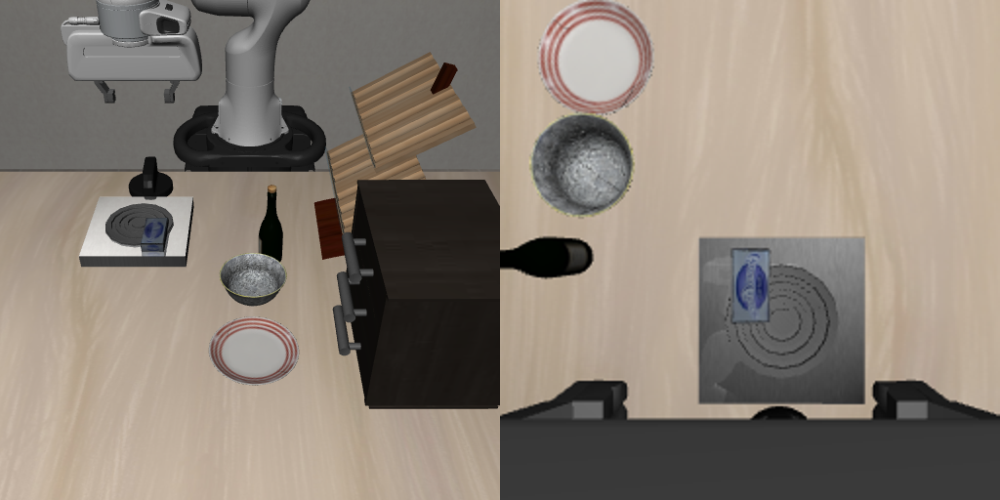
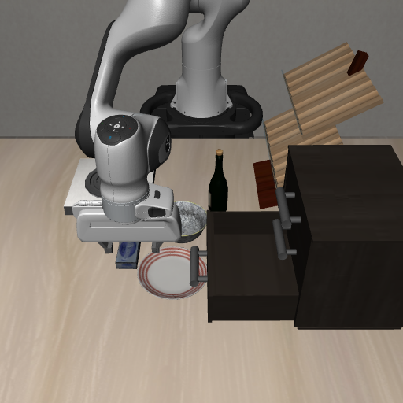

# 连续组合指令：故障定位与修复记录

本轮固定场景的 8 条组合指令，修复后完整执行 6 条、未完成 2 条。原记录为完整 2 条、部分 1 条、未完成 5 条。**这不是通用成功率，也不代表抽屉放入、取出与自动脱困已经做完。**

使用 Qwen3-VL 中文理解、当前 RGB-D 定位和几何抓放/OSC 控制。本轮没有训练模型，不是端到端 VLA。仿真真值仅用于动作后的独立核对，没有输入控制器。

## 找到的问题及已保留的修复

| 问题 | 证据 | 修复与复测 |
|---|---|---|
| 整体规划把浅盘当深容器，执行器却按支撑面处理 | 原 `bottle-plate-chain`、`cheese-chain` 失败 | 两处提示词统一浅盘 `support_surface/on`、碗 `circular_container/in`，仍要求识别原目的地；两条组合现已完成 |
| 模型把第二层框到第一层；底层的深度参考混进桌面 | 原中层命令实际拉开顶层，原图与本轮深度夹具 | 模型选柜体和层数，当前深度检查三根水平把手并按高度排序；静止参考只用上下方竖直面。中层开关、底层打开的实测关节均正确 |
| 打开后关闭时，模型可能重新框到后面的柜面 | `drawer_open_middle.npz` 与当前观测 | 同一组合内保留已核验打开记录，只作搜索范围；必须从新深度重新找到把手，再测量和执行 |
| 桌面的凸包包括灶台底座，最近落点并不空 | 原桌面命令误落灶台底座 | 当前点云中高于支撑面的障碍物参与落点净空检查；实测酒瓶离爪、回到桌面高度，未落灶台 |
| 薄盒沿用统一 6 cm 余量，盘内可见落点全部被排除 | `diagnostics/plate-clearance.log`（本机完整日志保留于 `.local`）；原薄盒盘子失败 | 薄物体用可见半径加 12 mm，最小 35 mm；高物体保留原余量。盘子放入和取出搬到灶台现已执行 |
| 叶子任务偶尔只输出 source，目的地 JSON 缺失 | `diagnostics/serialization-probe.json` | 实际指令前重申四个完整根字段，不补造目的地、不增加重试；最终本轮八条没有该解析故障 |
| 请求带了腕部图，完成判断服务却只处理第一张全景 | `completion-model.json` 的输入哈希与 `model_service.py` | 抓放完成核对把同一时刻的全景和腕部图拼入第一张；独立物理检查不变。原“盒子已在灶台但无法确认”这次完成 |
| 动作未完成却不断重看，现场不变 | 原未收敛/深度拒绝记录、恢复守卫测试 | 未完成运动或深度不通过时禁止纯 reverify；这只消除无效重看，不等于实现脱困 |

## 最终实际结果

LIBERO goal 任务 9、初始状态 0、随机种子 7。每组 case 重置一次；组内后续指令直接接前一条结束状态，不重置。模型 `Qwen/Qwen3-VL-4B-Instruct`，revision `ebb281ec70b05090aa6165b016eac8ec08e71b17`。

| 组合指令 | 结果 | 独立核对 |
|---|---|---|
| 底层抽屉打开→关上→打开 | 3/3 | 底层最终约打开 15.28 cm，其他层未打开 |
| 酒瓶→盘子→柜顶 | 2/2 | 两处 `on` 谓词正确，已离爪 |
| 酒瓶→柜顶→灶台 | 2/2 | 两处 `on` 谓词正确，已离爪 |
| 接上条：酒瓶从灶台→桌面，再奶酪盒→柜顶 | 2/2 | 奶酪盒柜顶谓词正确；酒瓶高度约 0.89886 m、已离爪且不在灶台。桌面 `main_table` 谓词不存在，不能把该错误当通过 |
| 奶酪盒→盘子→灶台 | 2/2 | 两处 `on` 谓词正确，已离爪 |
| 中层打开→关上→底层打开 | 3/3 | 中层先开约 15.66 cm，再关闭；底层最后约开 15.01 cm；顶层未开 |
| 接上条：奶酪盒→底层，再关闭 | 0/2 | 抓取下降被盘沿挡住，未收敛后停止，盒子没有放进去 |
| 接上条：打开底层→取出盒子→桌面→关闭 | 0/3 | 前一步放入未成功；且当前开门定位要求三层关闭把手，面对已打开底层拒绝动作。这不是有效的取物能力通过测试 |

八条都未触发评测脚本的 240 秒总超时。失败抓取仍有内部运动收敛上限，但接触诊断已看到夹爪撞盘沿，不能据此把原因说成“步数太少”。

完成判断实际输入（左全景、右腕部，同一时刻）：



仍失败的抽屉前抓取现场：



可直接播放的实际录像：[盒子盘子→灶台第二步](runs/final-v12/cheese-chain/command-01/step-02/demo.mp4)、[抓取失败](runs/final-v12/drawer-chain/command-02/step-01/demo.mp4)。其他每个实际叶子动作目录均保留视频、输入/末帧、模型原始输出与物理核对。

## 未解决的部分与撤回的实验

`diagnostics/failed-grasp-contacts.json` 是独立诊断：夹爪 finger1 与 `plate_1_g4/g5` 接触，末端停在目标上方约 8 mm。几何控制器缺少能处理这种情况的抓取可行性检查与脱困闭环。简单换一个固定夹取方向虽然下降过去，却未稳定夹住，并使原成功的盘子取物退步；该实验已撤回，未留在生产代码。

下一步应单独验证：从当前 RGB-D 生成抓取候选，检查完整手指/手掌净空，受阻后撤离并重新定位、换候选，再用稳定夹持和物体抬起验证成功。不能仅让语言模型再说“抬起重试”、增加步数或放宽成功判定。

跨独立指令的抽屉打开上下文尚未共享；“已经打开时再打开”的无动作成功语义也尚未实现。没有把这两个缺口算作本轮修复。

当前用户打开的旧面板进程不会自动载入磁盘新代码，本轮实测使用独立离屏仿真。为保留现有操作现场，没有强制关闭该窗口。不能以旧窗口仍在运行来声称界面已升级。

`experiments/final-v8`、`final-v9` 保留中间结果；`final-v10` 为已撤回的夹取朝向实验（含失败片段）；`final-v11` 因模型服务端口未监听而全部 connection refused，属于**无效环境运行**，不计能力失败。恢复服务后才执行最终 `final-v12`。

## 复现与检查

从项目根目录执行（先保证模型服务 8911 已就绪，使用本机既有依赖环境）：

```bash
rtk proxy env OPENBLAS_NUM_THREADS=1 OMP_NUM_THREADS=1 MUJOCO_GL=egl \
  .venv-vla-sim/bin/python -u evidence/combination-tests-20261025/run.py \
  .local/combination-recheck-new-output

rtk proxy env OPENBLAS_NUM_THREADS=1 .venv-vla-sim/bin/python \
  evidence/combination-fix-20261026/check_evidence.py

rtk proxy env OPENBLAS_NUM_THREADS=1 .venv-vla-sim/bin/python -m pytest -q \
  tests --ignore=tests/test_vla_artifacts.py
```

新输出目录必须不存在。最终新鲜测试为 **266 passed，18 subtests passed**；排除的 `test_vla_artifacts.py` 在当前仿真环境缺少 `google_crc32c`，本轮未改 VLA 导出逻辑，也未另装依赖。没有运行需要真机的检查。

`check_evidence.py` 核对状态数组 SHA-256、组内状态连续性、完成模型实际输入图哈希、7 个成功抓放的物理谓词、6 个抽屉动作关节状态、桌面高度代理以及失败前置条件。其 PASS 表示归档和指定检查一致，**不表示所有任务已完成**。

`summary.json` 给出可移植路径，`runs/final-v12/` 保留原日志与小体积状态数组；大型 `geometry.npz` 仅留在本机 `.local/combination-fix-20261026/final-v12/`，用于回归的两份实测深度已压缩保存为 `tests/fixtures/drawer_*.npz`。`diagnostics/source-sha256.json` 固定本次评测使用的核心源码，`diagnostics/archive-sha256.json` 固定归档数据内容。
