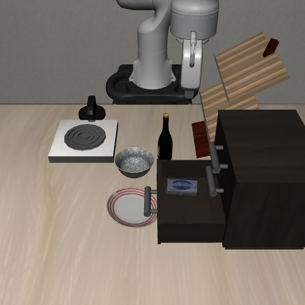
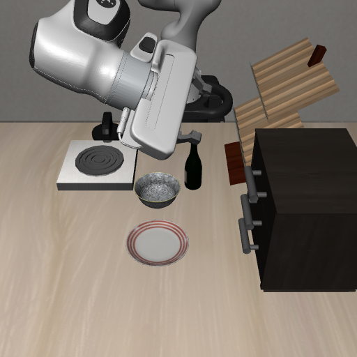

# 关抽屉把手检测修复（2026-10-25）

本次修复了上一轮 `panel-v2` 的具体失败：放入成功后，关抽屉在运动前被把手几何检查拦截。**原失败现场重测关闭成功，中文原生面板完整“自动打开→放入→关闭”也通过。** 这是固定场景回归，其他布局、遮挡和放置失败仍需验证，不能称为稳定成品。

[完整流程录像](panel-v3/demo.mp4) · [中文面板验收记录](panel-v3/receipt.json) · [原失败现场关抽屉录像](close-v1/demo.mp4)

## 原因和修复

根据原来保存的 698 个真实控制动作重新构造场景，得到的 RGB 图与原失败图逐字节一致，SHA256 为 `998ec46e92ed0348ea2bf08c66543fe9bfe7c4a71604fb52989b5b0642a47f8b`。动作回放仅用于构造诊断现场，新关闭动作仍由当前图像、深度和机器人自身状态产生。

独立定位框选中了打开抽屉的真实把手，但框里也有盘子/桌面背景。旧检测器只选世界高度直方图中点数最多的一层：

| 候选 | 高度 | 最高单箱点数 | XY 协方差长短轴比 | 旧结果 |
| --- | ---: | ---: | ---: | --- |
| 背景 | 0.909 米 | 486 | 3.85 | 未满足横杆阈值，直接失败 |
| 真实把手 | 0.954 米 | 312 | 约 17.1 | 没有继续检查这个候选 |

`vla/drawer_control.py` 现按支持点数依次检查高度候选，选择满足既有细长横杆条件的区域。没有降低形状阈值，没有绕过深度核验，也没有改写物体位置、强行附着或读取真值控制。


[修复前诊断](retained/diagnosis-before.json) / [修复后同图诊断](retained/diagnosis-after.json)。三项回归测试包括混合背景、保留现场点云、只有平面时仍拒绝。

## 实际执行证据

| 测试 | 结果 |
| --- | --- |
| 精确原失败现场，重新请求真实视觉模型后关闭 | 成功，253 个新增控制步；[记录](close-v1/receipt.json) |
| 独立物理诊断 | 底层抽屉关节从 −0.149378 米变为 +0.001611 米，距离零位约 1.6 毫米；奶酪盒随抽屉移动，高度保持不变 |
| 相机深度核验 | 把手向内移动 0.149207 米；最终把手距离静止柜面 0.021244 米；通过既有检查 |
| 中文面板实际“执行当前指令”按钮 | 自动补开抽屉 263 步，放入 435 步，关闭 253 步；951 步后 `running=false`，保留现场 |
| 完整面板运行的前 698 步 | 与原失败运行逐元素完全相同；修复影响的是后续关闭能力 |




面板一开始的任务定位格式被拒绝，零步执行；模型随后选择补开抽屉并继续原任务，已保留在 [完整结果](panel-v3/result.json)，没有删除失败尝试。`inference_calls=0` 是继承的动作策略计数字段，并不表示没有调用视觉模型；`request_timings` 保存实际 `/drawer`、`/locate`、`/verify` 请求。

录像按仿真帧 20 FPS 编码，952 帧、47.6 秒（放置额外保留一张观察帧），**没有填充模型等待时间，不代表墙钟反应速度**。原失败现场无窗口关闭约 4.52 秒；中文面板受实时显示节拍影响，关闭约 19.33 秒。未重新训练 Qwen 或 π0.5，这仍是 Qwen3-VL＋RGB-D／OSC 模块化执行。

## 是否需要强化学习

这次首先是感知候选筛选错误：还没开始执行就被拦住，增加奖励数字不会改变当前推理权重。真正做强化学习需要定义观测/动作、奖励、采样和参数更新，再用留出场景验证。

后续可把“接触后调整并关严”做成有界学习技能：奖励抽屉关闭且物体留在内部，惩罚碰撞、掉落、过度施力和无进展耗时；随机化开度、物品位置、摩擦和把手定位误差。奖励必须约束完整终态，避免通过撞击或挤出物品刷分。优先保留当前工程修复作为基线，再与学到的策略对照。本次没有启动 RL 训练。

robosuite 官方提供[稀疏/稠密奖励和环境交互接口](https://robosuite.ai/docs/modules/environments.html#rewards-and-termination)，这些接口本身不等于已经训练出策略。

## 复现与检查

项目根目录执行；输出必须是新目录，模型服务 8911 需已就绪。复现场景使用仓库中保存的动作文件，不依赖原 `.local` 目录。

```bash
rtk proxy env OPENBLAS_NUM_THREADS=1 OMP_NUM_THREADS=1 MUJOCO_GL=egl \
  .venv-vla-sim/bin/python evidence/drawer-handle-fix-20261025/reproduce.py \
  runs/drawer-diagnosis-new
rtk proxy env OPENBLAS_NUM_THREADS=1 OMP_NUM_THREADS=1 MUJOCO_GL=egl \
  .venv-vla-sim/bin/python evidence/drawer-handle-fix-20261025/close_retained.py \
  runs/drawer-close-new
rtk proxy env DISPLAY=:0 MUJOCO_GL=glfw __NV_PRIME_RENDER_OFFLOAD=1 \
  __GLX_VENDOR_LIBRARY_NAME=nvidia OPENBLAS_NUM_THREADS=1 OMP_NUM_THREADS=1 \
  .venv-vla-sim/bin/python evidence/continuous-recovery-20261025/panel_check.py \
  runs/drawer-panel-new runs/drawer-panel-new-receipt.json
rtk proxy env OPENBLAS_NUM_THREADS=1 .venv-vla/bin/python -m pytest -q tests
```

全项目指定 `tests/` 检查 253 项通过。独立代码评审子代理因本账号不支持配置中的模型未能启动；已直接检查改动及运行回归，不声称完成独立评审。仍保留[历史失败报告](../continuous-recovery-20261025/README.md)，其中 `drawer-v5` 的放置接触失败不属于本次修复。
