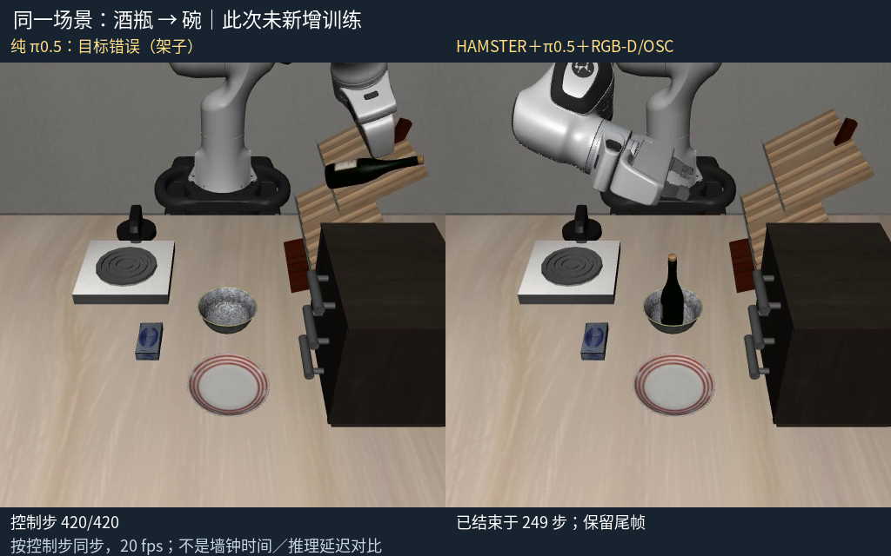

# HAMSTER 中文指令物理抓放：实测与复盘

日期：2026-10-25。此次没有重新训练模型，未连接真机，保留已有模型服务和旧训练项目。

## 本次解决了什么

此前官方 π0.5 和 MolmoAct2 在这张桌面上接到“酒瓶放进碗里”时仍偏向训练中的架子。现在实际运行官方 HAMSTER，根据相机和文字生成目标路径；实际官方 π0.5 执行抓取，再由 RGB-D／OSC 几何控制完成抬起、移到目标、松爪、撤手。酒瓶确实进入碗中，碗也可放到盘子上。

**这是一套混合方案。** HAMSTER 是真实预训练模型；π0.5 抓取动作也来自真实模型。后半程是手写的通用几何控制，未补出 HAMSTER 论文未公开的学习型底层策略，不是端到端 VLA。未用物品名称查表选择目的地，也未将模拟器物体真值传给控制器。使用固定 LIBERO goal8、初态0、seed42，深度只在初始画面采集。

## 直接看结果

- [同场景左右对比录像](hybrid-comparison-01/bottle-bowl-before-after.mp4)：左为完整纯 π0.5，右为混合方案。相同输入画面、指令、seed、预测种子规则和每次执行5步。按控制步对齐20 fps；右侧结束后保留尾帧并明确标注。不是推理耗时或墙钟速度对比。
- [最终对比图](hybrid-comparison-01/comparison-final.png)：左侧酒瓶在架子，右侧酒瓶在碗中。
- [新中文输入实际录像](hybrid-fresh-chinese-01/execution/rollout.mp4)，[逐阶段记录](hybrid-fresh-chinese-01/workflow.json)。原话“帮我把酒瓶放进碗里面”，经真实本地 Qwen 翻译为“Please put the wine bottle into the bowl.”，重新运行 HAMSTER，不使用已缓存目标路径。
- [中文面板和原生 MuJoCo 截图](hybrid-panel-fresh-acceptance-01/chinese-panel-and-mujoco.png)，[实际按钮验收记录](hybrid-panel-fresh-acceptance-01/acceptance.json)。顶部双摄像头属于旧工作台场景，此实验另开固定场景，截图中这两处未加载。右侧是实际新场景。
- [中文合成语音完整执行录像](hybrid-fresh-voice-01/execution/rollout.mp4)、[语音流程记录](hybrid-fresh-voice-01/workflow.json)和[音频来源与识别结果](hybrid-voice-command.json)：真实 ASR、翻译、重新规划、物理执行共67.53秒；不是预先把文字当作识别结果。真人麦克风尚未验收。
- [碗放盘子录像](hybrid-depth-bowl-plate-01/rollout.mp4)与[分帧图](hybrid-depth-bowl-plate-01-contact-sheet.png)。



## 结果与评分边界

| 记录 | 控制步 | 实测结果 |
| --- | ---: | --- |
| hybrid-matched-policy-bottle-01 | 420 | 纯 π0.5，酒瓶去了架子，目标关系失败 |
| hybrid-depth-bottle-bowl-01 / 02 | 247 / 248 | 混合方案，酒瓶与碗关系评分通过 |
| hybrid-depth-bowl-plate-01 / 02 | 251 / 251 | 混合方案，官方碗在盘子判据通过 |
| hybrid-panel-01-1792861386965294177 | 249 | 实际中文复现按钮，评分通过；已检查抓取、松爪、撤手画面 |
| hybrid-fresh-chinese-01 | 180 | 新中文实际规划和执行完成；画面确认酒瓶直立在碗里，夹爪张开且撤手 |
| hybrid-panel-fresh-1792861771830963802 | 180 | 实际新指令按钮完成；录像复核酒瓶在碗内、夹爪张开撤手；自动语义分数为空 |
| hybrid-fresh-voice-01 | 180 | 合成中文语音经真实本地识别、翻译、新规划和执行；录像确认放入碗中并撤手；自动语义分数为空 |

同一初态重复运行是工程复现，不是独立泛化样本，不能合计成家庭场景成功率。酒瓶→碗评分为明确的近似判据：物品接触、XY中心距小于3cm、Z中心差小于8cm、连续5步无夹爪接触，并需要画面复核；不是严格容器包含几何判定。新中文任务保留 `success:null` 和 `semantic_scoring:false`，避免把原任务的“碗在盘子”判据冒充语义完成。

## 遇到的问题与实际处理

| 问题 | 证据／原因 | 处理 |
| --- | --- | --- |
| 原 VLA 目标偏向架子 | 同场景纯策略420步录像仍去架子 | 使用真实 HAMSTER 的新目标点，后半程切换几何控制；没有声称模型经训练学会了组合 |
| 图像与深度方向不同 | 规划图旋转180°，深度先上下翻转 | 按真实相机内外参重建，单独处理左右镜像；保存标定与输入 SHA256 |
| 酒瓶和碗在二维图上连成一块 | 普通二维连通域不能分离不同深度 | 用相邻像素的三维距离划分区域，避免混成一个目标 |
| 直接用模型像素落点偏向边缘 | 碗表面可见边界与中心不同 | 用深度连续区域的稳健可见XY边界中点估计目标 |
| 薄碗抓住边缘但不触发接管 | 夹爪间距阈值过严 | 放宽候选抓取间距，并根据初始源物体点和最低闭合位置估计抓取偏移；候选仍不是实际抓住的证明 |
| 碗放到盘子边缘 | 直接偏移补偿被原始可见像素偏差放大 | 修正源物体区域中心后再补偿；保留失败录像 |
| 输出目录已有文件 | 运行器拒绝覆盖，日志预填也会触发 | 时间戳新目录，日志写在目录外 |
| 停止按钮只停父进程 | CPU规划子进程可能继续 | 每个实验独立进程组，只终止本面板拥有的组；取消和互斥有测试 |
| 进度JSON写入时面板读到半截 | 轮询与写文件并发 | 先写临时文件再原子替换 |
| 合成语音工具启动环境错 | `.venv-models` 没有 piper | 改用已有独立 `.venv-tts`，未修改模型服务依赖 |

## 所有早期失败均保留

- `hybrid-bottle-bowl-v1`：0步异常，服务响应需先取动作字段再校验。
- `hybrid-bowl-plate-v1`：179步异常，薄碗抓取候选未触发。
- `hybrid-bowl-plate-v2`：217步目标关系失败，放置偏盘沿。
- `hybrid-offset-bowl-plate-01`：255步目标关系失败，直接像素补偿偏置。
- `hybrid-bottle-bowl-v2`、`hybrid-fixed-bottle-bowl-01` 为中间开发版本，成功判据通过也不代表最终控制器。完整原始 [trial-index.json](trial-index.json) 保留中间成功和失败。

早期开发版本有些未记录源码 SHA，部分后续版本记录历史控制器 `34c4f167…`，当前源码 `3800ef71…` 增加了新指令不评分分支。它们是历史观测，不能宣称都由当前源码逐字复现；当前新中文、面板、语音试验记录当前源码 SHA。模型采样可能受后端数值影响，固定种子不保证跨机器逐字节动作一致。

## 使用入口

按 [VLA 安装与启动](../../../vla/README.md)打开中文工作台，在“结果与录像”页找到“HAMSTER 分层模型实验”。

- 直接复现两个已审核按钮，或在顶部输入自己的单次抓放中文，点击“按上方中文指令重新规划并执行”。
- 语音先点现有录音按钮，核对识别文字，再点新指令按钮。命令行 `--audio` 会真实调用 ASR。
- 此实验固定布局0，不能在上方改布局后误认为实验会使用那个布局。CPU规划约一分钟至几分钟；物理执行完成后自动保存录像并关闭实验窗口。
- 实验期间不能同时操作原场景或开始训练；关闭面板只停止本面板启动的进程，不停止其它GPU任务。

```bash
cd /home/robot/voice-arm-sim
rtk proxy .venv-vla-sim/bin/python -u -m vla.hamster_command --prompt '帮我把酒瓶放进碗里面' --output runs/hamster-new-01 --viewer
rtk proxy .venv-vla-sim/bin/python -u -m vla.hamster_command --audio /绝对路径/中文录音.wav --output runs/hamster-voice-new-01 --viewer
```

要复现严格匹配的纯策略对比，可对同一已审核计划分别调用 `vla.hybrid`，仅左侧增加 `--policy-only`，再使用 `scripts/compare_hybrid_demo.py` 合成。所有输出须使用新目录；原始 MP4、动作与校准数据保持原样。

## 验证和未完成的产品目标

30项定向测试和4项子测试通过，Ruff检查新增控制器／中文入口／面板／对比脚本／新增测试通过；实际中文按钮、新中文规划、合成中文语音均有独立录像与分帧复核。代码另经本次主代理直接检查；配置的独立审查子代理模型不受运行环境支持，未声称完成独立子代理审查。模型、环境与官方源码版本沿用[已固定的环境与模型清单](../README.md)。大权重不上传Git。原始模型提示词保留上游行尾空格，未为通过差异检查改写取证文件；源码差异检查通过。

**还未完成任意家庭物品语音抓取产品。** 当前只验收一张固定桌面图和两类抓放；没有证明新物品抓取、移动后的重规划、连续多任务、遮挡/碰撞避障、失败恢复、真人麦克风、真实廉价机械臂或儿童使用可靠性。控制器只取 HAMSTER 的源／释放点，不沿模型整条路径避障，抓取仍依赖 π0.5 的训练能力。下一轮应先测多个初态和未知物品，再决定补充通用抓取策略与恢复数据；不能凭这两段 Demo 宣布产品可售。
