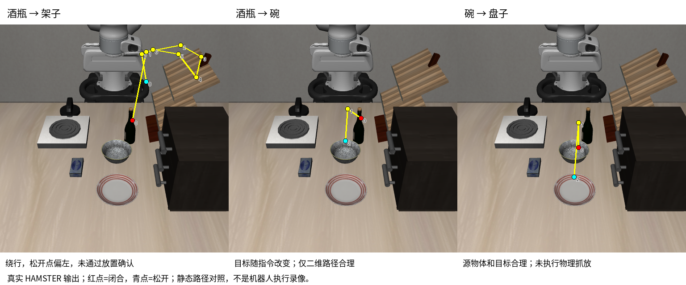

# HAMSTER 同画面换目标：实际模型测试

2026-10-25。官方 13B checkpoint 的三条真实推理均正常结束，未微调、未补造轨迹。**换成“酒瓶放进碗里”后，模型确实将松开位置改到碗区域。** 这是一张固定画面上的路径级证据，尚未证明机械臂可以完成抓放。

| 固定指令 | 闭合位置 → 松开位置（归一化图像坐标） | 人工检查叠加图 | CPU 生成耗时 |
|---|---|---|---|
| 酒瓶放架子 | (0.58,0.42) → (0.64,0.25) | 抓取点在酒瓶；路径经过架子，但绕行后在架子左侧松开，放置不确定 | 466.18 秒 |
| 酒瓶放碗里 | (0.58,0.41) → (0.51,0.51) | 抓取点在酒瓶，松开点在碗区域，二维目标合理 | 47.44 秒 |
| 碗放盘子 | (0.53,0.54) → (0.51,0.67) | 抓取点在碗，松开点在盘子区域，二维目标合理 | 44.61 秒 |

首条耗时包含首次访问内存映射权重的机械硬盘读取等待，且输出更长；后两条使用已缓存权重、输出更短。不能把这些耗时解释为机械臂动作速度，也不能直接据此推算纯模型吞吐。输出 token ID 长度分别为138、66、66（包含特殊 token）。

## 原始证据

- 每条指令的 `command-00/01/02.prompt.txt`、`.raw.txt`、`.json`、`.overlay.png` 全部保留，原始 JSON 中的 `semantic_success` 仍为 null，`physical_execution` 为 false。
- `run.json` 保存官方 checkpoint/VILA 版本、图像 SHA256、精度、seed42和线程配置；`execution.json` 保存实际命令与退出码0。`inference.log` 为完整生成日志。
- `visual-review.json` 单独记录人工审查、夹爪事件坐标与预先选定的参考区域；参考区域没有输入模型或控制器。粗略矩形用于复核，不是物理抓取成功指标。
- 三条测试使用相同的 LIBERO/MuJoCo 初始画面，只有文字指令不同；中文含义由预先固定的英文翻译输入。本轮没有测试中文语音端到端，也没有在另一视角、另一摆放或多种随机种子上评测。

## 对工程路线的意义

此前 π0.5 和 MolmoAct2 的实际 rollout 在“酒瓶放碗里”时仍将瓶子移向架子，记录在 [MolmoAct2 报告](../../molmoact2/README.md)。本轮 HAMSTER 能在同类场景的二维规划层面改变目标，是有价值的候选证据；由于输出接口和评价方式不同，不能将本轮路径结果与前述物理 rollout 合并为模型成功率对比。

下一关是底层执行：把二维路径结合深度、夹爪姿态、碰撞、抓取和释放控制，在 MuJoCo 中真的完成动作。固定版本的 HAMSTER_beta 公开了路径服务与展示接口，没有在该仓库发布完整可直接运行的低层执行器。现有 π0.5 checkpoint 也没有直接接收 HAMSTER 路径的接口，需要集成或训练一个兼容执行策略；仅把路径画到画面上无法补齐这一步。

因此当前交付是**真实模型的路径可行性测试与对照图**，尚没有 HAMSTER 驱动机器人抓放的 Demo，不保证任意家庭物体或任意命令都能完成。架子指令自身的路径质量也需要继续验证。

## 遇到的问题与处理

1. Hugging Face 下载 TLS/超时：保留已下载内容，分块重试并核验18个官方文件的完整 SHA256。
2. 上游动态导入生成缓存导致干净源码检查失败：归档缓存，仅在动态导入期间抑制字节码，增加回归检查。
3. 官方 LlamaTokenizer 的 legacy=False 缺少 protobuf：实际复现后，仅给独立 HAMSTER 环境补入 protobuf==4.25.8；官方分词器加载和编码通过，34个包依赖兼容。
4. GPU 已有服务占用大部分显存：保留现有服务，独立 CPU/BF16 推理；与官方 CUDA/FP16 存在数值差异，不宣称逐位等价。

本轮13项针对性测试及 Ruff 通过。旧 π0.5 学习项目和其他 GPU 服务均未修改或终止。
