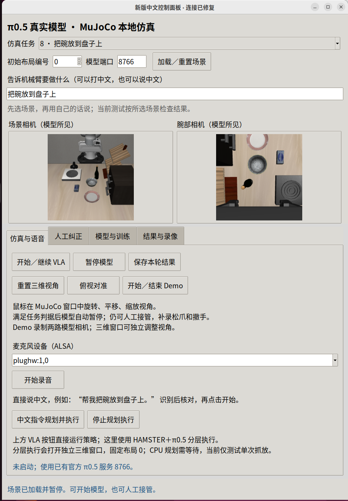

# 中文面板控制修复

## 复现与原因

旧面板显示 `sent 1011 (internal error) keepalive ping timeout`。慢同步推理阻塞服务端 pong，旧客户端断开后，继续按钮仍复用已关闭连接。运行中的旧面板也不会自动加载新增 HAMSTER 入口。

## 修改

- 客户端等待 pong 不再触发断线；连接建立15秒、接收120秒的上限保留。
- 用户明确点击继续时，断开的策略连接重连到原端口并核对完整模型元数据；失败维持暂停，丢弃排队动作，不自动重放。
- 首页新增“中文指令规划并执行”和“停止规划执行”，复用已有 HAMSTER 流程。此入口使用独立窗口和固定布局0；并非当前人工编辑场景的规划器。

## 验证

- 人为关闭客户端连接后，从面板继续，原场景实际执行5步控制后暂停。
- 实际调用首页按钮，输入“请把酒瓶放到碗里面”，执行了本地翻译、官方 HAMSTER CPU 规划、π0.5 抓取及 RGB-D/OSC 转移，共180控制步，子进程退出0。
- `acceptance.json` 保留真实结果 `motion_completed_unscored`、`success: null`。验证了控制链路，不将运动完成解释为语义任务成功，也不宣称通用抓放可靠性。
- `.venv-vla/bin/python -m pytest -q tests`：89 passed。
- Ruff：本次修改的 Python 文件全部通过；`git diff --check` 通过。

## 操作

在新版中文面板首页输入中文，点击“中文指令规划并执行”；CPU规划需等待约1分钟，之后打开独立 MuJoCo 窗口。直接运行选定 VLA 用“开始／继续 VLA”。手工操作到“人工纠正”页先接管，再使用摇杆。
