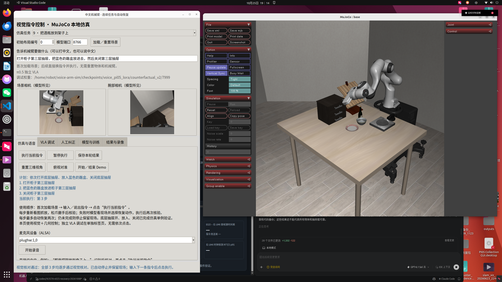
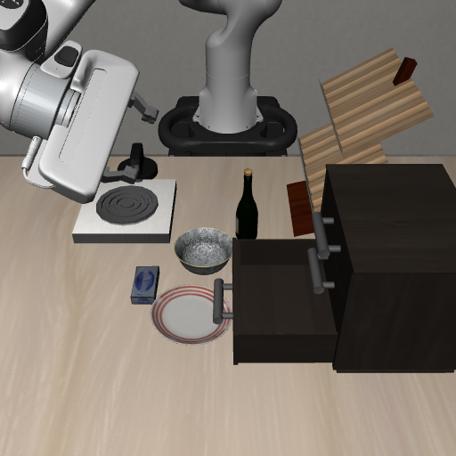
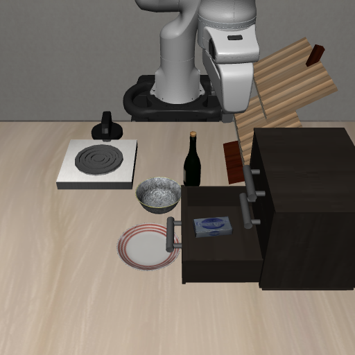
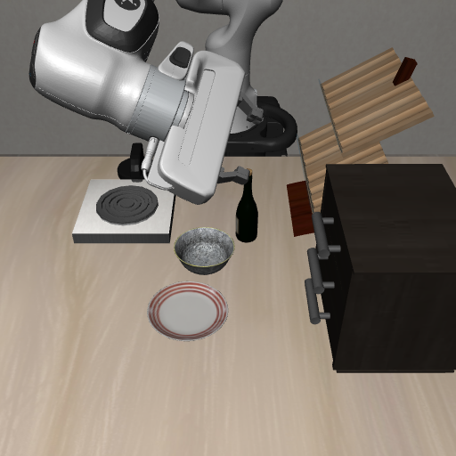

# 连续抽屉任务与实际自动恢复

历史版本说明：下文“两次恢复”描述当时版本。后续持续恢复、前后画面对照与缺失前置动作规划见[新报告](../continuous-recovery-20261025/README.md)，旧证据保持原样。

2026-10-25。本次补齐了上一版缺失的抽屉技能和恢复执行路径。这里使用 **Qwen3-VL-4B-Instruct 理解、定位、判断及选择恢复动作，RGB-D 与 OSC 执行物理技能**。没有新增训练，不是 π0.5 端到端动作预测。旧 VLA 调试入口独立保留。

## 实际结果

| 实验 | 本次结果 | 证据 |
| --- | --- | --- |
| 打开底层抽屉 → 奶酪盒放入 → 关闭 | 3 步完成，969 控制步；逐步视觉核验后自动停止 | [录像](sequence/demo.mp4)、[执行记录](sequence/result.json)、[独立物理诊断](sequence/physical.json) |
| 同一任务通过中文面板实际按钮执行 | 3 步完成，970 控制步，`running=false`，保留结束现场 | [当前按钮验收](panel-current-check.json)、[原生窗口截图](panel-current.png) |
| 首次空抓后恢复 | 模型选择 `retry_grasp`；实际退让、重看、重抓、放置成功；共314控制步 | [录像](empty-grasp/demo.mp4)、[记录](empty-grasp/result.json)、[独立评分](empty-grasp/physical.json) |
| 抓起后、运输前中断 | 模型选择 `resume_place`；保持夹持，重新找目的地，继续放置成功；共264控制步 | [录像](held-interruption/demo.mp4)、[记录](held-interruption/result.json)、[独立评分](held-interruption/physical.json) |
| 开关完成误判拦截 | 关闭/打开各正负例，共4例符合预期 | [深度与模型联合核验](verification-depth-final/results.json) |

以上是固定 LIBERO_GOAL task 9、初始状态0、种子7的功能验收，**不是成功率统计**。只实测了底层抽屉与奶酪盒；上、中层虽可解析，未验证其物理操作。两类恢复使用明确的受控故障注入，不能据此宣称覆盖所有自然失败。



### 抽屉过程截图

| 打开后 | 放入后、关闭前 | 关闭后 |
| --- | --- | --- |
|  |  |  |

控制器根据相机测得把手外移约15.19cm、随后内移约15.23cm。独立仿真诊断的底层抽屉结束位移约1.66mm，奶酪盒位置仍在柜内。诊断读取仿真关节与物体真值，**只记录，不反馈给控制器**；控制动作不读取物体 ID、物体位姿或抽屉关节。

录像由每个实际控制步的仿真帧按20fps拼接，无动作加速；段间包含边界帧，所以帧数略大于控制步数。三段分别为970帧/48.50秒、316帧/15.80秒、265帧/13.25秒。录像不包含模型请求期间的静止等待，不能作为交互墙钟延迟。无显示加速计算耗时分别约18.14、7.77、6.10秒，也不是原生交互时长。多步之间、恢复前后没有重置场景或瞬移物体。

## 为什么上一版失败

1. 上一版把抽屉动作列为缺少技能，在执行前拒绝；不是大模型已经尝试打开后失败。
2. 失败反馈原来只保存建议、`executed=false`，没有调用恢复动作；这一点不满足自动恢复目标。
3. 大模型可以理解“抬起重抓”，但必须有能执行的物理技能、当前观测、持物状态保护和完成核验。仅输出一句规划不会改变机械臂状态。

## 本次闭环

```text
中文完整指令 → 模型分解完整计划并校验技能
  → 每步从当前 RGB-D 重新定位 → 执行 → 松爪/撤手 → 核验
  → 失败：当前图像 + 指令 + 执行日志 + 持物上下文
      → 模型选择允许的恢复动作 → 实际执行 → 再核验
      → 成功继续剩余步骤；仍失败则保留现场并明确停止
```

每步最多两次自动恢复，避免无限重复下压或反复开爪。已执行成功的前序步骤不会重放。停止条件来自核验结果与恢复预算，不把控制步数到达等同于任务完成。

恢复动作包括重抓、持物续放、仅重新核验、重新操作抽屉和停止。可能持物时禁用会主动松爪的重抓；没有抓取上下文时禁止凭空续放。重新核验会保留持物上下文，防止第二轮恢复忘记手中有物体。该上下文保护有回归测试；实际空抓/持物中断两条演示没有经过“重新核验再恢复”分支。

大模型不是无约束地产生任意机器人代码，而是在已有技能中按当前图像选择动作。未知动作仍会在运动前明确报告缺少技能。复杂卡死、物体掉出视野、碰撞避让、任意抽屉与任意物品的恢复尚未验证。

## 遇到的问题与处理

| 问题 | 原因与修改 | 证据/边界 |
| --- | --- | --- |
| 低层把手抓不到、手掌碰桌 | Panda手掌较宽；改为相机估计柜面法向与把手方向，倾斜夹持、接触式拉/推 | 实际开/放/关通过；不是通用碰撞规划器 |
| 推入后持续顶住柜面 | 到达关闭端点时末端停止前进 | 检测停滞后松爪撤手，再做完成核验；停滞本身不算成功 |
| 小薄盒夹爪闭合在盒子上方 | 旧抓取高度给薄物体留下过大间隙 | 调整相机测量的薄物体TCP高度；放入时手掌沿抽屉宽度对齐 |
| 放瓶时往柜面下压 | 瓶底遮挡，可见点底部高估支撑面约26mm | 使用物体邻域可见水平面估计底部支撑高度；保留高台支撑回归 |
| 盒子没有落入抽屉底部 | 开口内部不能照搬普通桌面放置 | 从模型指定区域的当前深度估计抽屉底部及可见内侧落点，留物体边界余量；松开后由物理重力落下 |
| 模型把关闭抽屉说成已打开 | RGB语义核验也会错 | 增加相机深度位移与终态双门槛；深度只能否决，不能将模型未通过升级为成功 |
| 模型JSON出现多余包装括号 | 定位重试返回了完整字段，但`destination`外层多一对括号 | 精确修复这一已观测格式，保留模型原值，不编造坐标；原失败见[记录](failed-sequence-v17/result.json) |
| 第二次恢复丢失持物上下文 | 重新核验创建了新报告 | 保留`grasp_context`、抓取几何和动作完成状态；新增回归先失败后通过 |

[仅RGB核验的早期失败记录](verification-final/results.json)保留。最终四例中，“关闭图被问是否打开”的原始模型回答为`completed`，相机位移0将其拦截；开图确认开、闭图确认闭通过；开图确认闭被模型和深度同时否决。最终原始模型输出与门槛均在[同一JSON](verification-depth-final/results.json)，没有改写成全对的模型结果。

抓放完成目前仍依赖视觉模型核验，有误判可能；深度位移双门槛专门用于抽屉开关，不代表所有任务都具备独立可靠判据。夹爪宽度与稳定性只是持物候选检查，实际录像及独立物理评分另存。

## 代码与操作

- [task_runner.py](../../vla/task_runner.py)：完整计划、逐步执行、失败恢复预算与保留现场。
- [recovery.py](../../vla/recovery.py)：模型恢复输入/输出契约。
- [drawer_control.py](../../vla/drawer_control.py)：RGB-D抽屉操作、位移核验。
- [visual_control.py](../../vla/visual_control.py)：重抓、持物续放与重新核验。
- [model_service.py](../../model_service.py)：实际Qwen规划、定位、恢复及核验请求。

中文面板使用顺序：首次“加载/重置场景” → 输入/说出完整指令 → 点“执行当前指令”。每步失败会显示恢复动作；结束自动停止并保留场景，下一条指令直接输入再执行。**不需要依次点击视觉控制和VLA按钮**，独立VLA入口位于“VLA调试”标签。框中的8766是独立VLA服务端口，本页视觉控制使用8911，不会调用VLA预测。

本机已有独立环境和模型时，启动模型服务：

```bash
cd /home/robot/voice-arm-sim
rtk proxy env OPENBLAS_NUM_THREADS=1 OMP_NUM_THREADS=4 .venv-models/bin/python -u model_service.py
```

另开终端启动普通中文面板，输出使用新的目录：

```bash
cd /home/robot/voice-arm-sim
rtk proxy env DISPLAY=:0 MUJOCO_GL=glfw __NV_PRIME_RENDER_OFFLOAD=1 __GLX_VENDOR_LIBRARY_NAME=nvidia OPENBLAS_NUM_THREADS=1 OMP_NUM_THREADS=1 .venv-vla-sim/bin/python -u -m vla.run --suite libero_goal --task-id 9 --seed 7 --panel --viewer --output runs/drawer-live-new
```

以下会分别新建独立仿真实例验证本报告，不操作真机；需模型服务8911已就绪：

```bash
rtk proxy env MUJOCO_GL=egl OPENBLAS_NUM_THREADS=1 OMP_NUM_THREADS=1 .venv-vla-sim/bin/python -u evidence/recovery-drawer-20261025/sequence_trial.py runs/drawer-sequence-new
rtk proxy env MUJOCO_GL=egl OPENBLAS_NUM_THREADS=1 OMP_NUM_THREADS=1 .venv-vla-sim/bin/python -u evidence/recovery-drawer-20261025/recovery_trial.py runs/drawer-empty-new
rtk proxy env MUJOCO_GL=egl OPENBLAS_NUM_THREADS=1 OMP_NUM_THREADS=1 .venv-vla-sim/bin/python -u evidence/recovery-drawer-20261025/recovery_trial.py runs/drawer-held-new --holding
```

空抓测试让第一次在自由空间闭爪；持物测试在正常抓起后、运输前注入异常。后续恢复均调用实际模型，并实际运动。脚本中物体ID只用于独立诊断，不参与控制。输出目录不得覆盖旧记录。`inference_calls=0`表示VLA动作预测调用为0；实际Qwen请求在`request_timings`中。

## 验证与保留资料

`tests/`共229项通过，包含恢复路由、持物保护、计划契约、抽屉几何、完成误判、模型JSON格式与取消行为。最终输出见[测试日志](tests.log)。另外完成真实模型的三步仿真、两种受控恢复、四例完成核验与中文面板按钮验收。单元测试不是物理成功率。独立代码评审代理因账户不支持其配置模型未运行，已做主代理自查并补上持物上下文回归，不能称作独立评审通过。

`panel-check.json`、`panel-running.png`是早期失败验收；`panel-final-check.json`是修正后的首次通过；**最后一次新进程验收是`panel-current-check.json`**。原始大量探索保留在本机`runs/recovery-drawer/`，仓库只选入成功证据和关键失败，不上传模型权重、虚拟环境或庞大深度缓存。

本次代码实际所在仓库及可写远端已核对为`sencangWei/voice-arm-sim`的`feature/visual-semantic-grasp`分支。能力提交`af2b6d944c368be30d1a87c606bd6805dab56fd6`已推送，并从GitHub重新提取到独立目录，1823个跟踪文件的内容与执行权限全部一致，见[远端恢复回执](backup.json)。本机`.local/visual-control-20261025-final-remote-restore.json`另保存包含后续回执文档提交的最终核对，以其中`verified_commit`为准。
