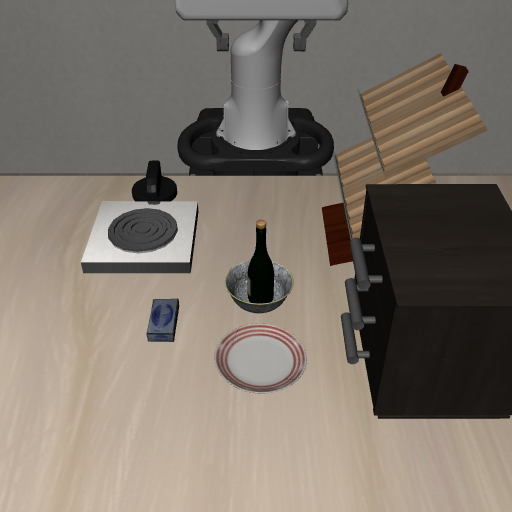

# 中文连续抓放：视觉定位与通用控制

用户选择：允许视觉模型定位＋通用抓取控制，先实现连续指令。此次没有训练；上方“执行当前指令”不调用 π0.5 动作策略。模型根据当前图像选择物体和目的地，控制器从实际相机深度计算新的抓取、放置位置，再执行通用抓放阶段。没有按中文命令预存每个目的地的轨迹或物体坐标。

## 实际连续执行结果

从之前操作失败后保留的现场开始，同一个 MuJoCo 环境依次执行，没有中途 reset、set_init_state 或重新摆放。初始状态 SHA256：`2335c0edc3a68069c8299f04dc0552aa1a6460f0024e7fed7daba65f5ebdf120`。

| 中文指令 | 实际控制步 | 墙钟用时 | 独立物理观察 | 录像 |
| --- | ---: | ---: | --- | --- |
| 把酒瓶放柜子上 | 286 | 48.76 秒 | 柜面 on 判据通过，夹爪无接触 | [第一条](continuous/command-1/demo.mp4) |
| 把酒瓶放到灶台上 | 292 | 47.68 秒 | 灶台 on 判据通过，夹爪无接触 | [第二条](continuous/command-2/demo.mp4) |
| 把酒瓶放到碗里面 | 321 | 83.11 秒 | 接触碗、中心接近、已松爪，连续 88 个控制步满足入碗近似判据；最终画面人工复核 | [第三条](continuous/command-3/demo.mp4) |

这是一个固定现场的三条连续指令验证，不是开放场景成功率。入碗独立评分要求两物体接触、XY 中心距离 <3 cm、Z 中心差 <8 cm、夹爪不接触，连续至少 5 步；这是近似关系，需要结合录像。评分读取仿真真值，**只在外部观察器使用，不输入控制器**。



原始 [顺序结果与物理观察](continuous/sequence-result.json)、[现场回放一致性](continuous/retained-replay-check.json)、每条 `result.json`、`model.json`、`trace.json` 和放置后状态均保留。录像每个真实控制步一帧，20 fps；没有包含 CPU 看图等待时间，不能把视频时长当实际指令响应耗时。

## 中文面板也已实际验证

通过桌面面板输入相同三条指令、逐次点击“执行当前指令”，三条之间不重置。实际为 286／292／321 控制步，墙钟用时 65.03／64.45／66.33 秒。对应 [柜面录像](panel-command-1/demo.mp4)、[灶台录像](panel-command-2/demo.mp4)、[入碗录像](panel-command-3/demo.mp4)，以及 [第一条截图](panel-command-1.png)、[第二条截图](panel-command-2.png)、[第三条截图](panel-command-3.png)。首次 JSON 失败为零控制步，原始记录也保留在 `panel-json-failure/`。

另将面板保存的全部 899 个动作在独立环境按顺序回放：三条结束时的相机图片与原始图片逐字节相同，三次外部物理观察均通过，夹爪均已无接触。见 [回放核验](panel-replay-verification.json)。这验证了实际动作和场景延续，不只依赖视觉模型的 completed 回复。

回放时需要复现 OSC 控制器预热；仅恢复 MuJoCo 状态向量会遗漏控制器历史。面板核验脚本先按原加载过程预热 10 步，再恢复现场；独立命令演示则回放原失败动作以恢复控制器上下文。复核已保存的面板动作无需模型推理：

```bash
rtk proxy env MUJOCO_GL=egl .venv-vla-sim/bin/python \
  evidence/visual-control-20261025/verify_panel_replay.py
```

## 本次修复的问题

1. **连续指令仍依赖训练策略抓取**：上一个动作移走酒瓶后，π0.5 在新位置抓取不足。按用户允许的路线，面板上方改用 `vla/visual_control.py` 的相机深度抓取，独立 VLA 调试入口保留。
2. **抓取位置过低导致手掌碰撞**：上表面以下 5 cm 的接近位置会让 Panda 手掌撞到物体。改用可见上部点和经过夹爪几何校验的接近深度，闭爪后做稳定宽度检查。宽度检查只是候选筛选，不等于证明抓到物体。
3. **柜子上的酒瓶被高度过滤掉**：原先定位仅保留桌面以上约 30 cm 的点，柜面上的物体超出范围。源物体按当前模型框裁剪深度分量，允许更高位置；不把柜面坐标写进抓取路径。
4. **支撑面中位数混入柜子侧面，或落点太靠边**：目的地区域内提取水平面，从可见凸支撑面中选有 6 cm 边缘余量且接近当前物体的落点；灶台略高的炉圈也考虑真实测量高度。
5. **“入碗”落点偏向前侧碗沿**：旧表面中位数比圆沿拟合中心偏约 2.4 cm。改成从当前深度中的可见圆沿拟合中心，使用可见内部较低深度决定落点。圆沿不足、非圆形或拟合不可靠则停止。
6. **模型输出错误 JSON，导致操作失败**：对两种已复现的括号错误做严格形状匹配，只改括号，保留模型全部字段值；其它语法错误对同一图像最多再请求一次严格 JSON。仍错误则零动作退出，不编造物体坐标。`continuous/command-3/model.json` 留有实际重试证据；面板实测还复现了源物体、目的地对象缺少闭合括号，已补充回归测试。
7. **把旧场景任务成功混同于新命令成功**：面板不再用原始任务的 done 结束新指令。每条命令释放、撤手、稳定后，用当前图片核对，然后停止并保留现场；不确认也会停止，允许人工检查后继续下新指令。

## 失败也保留

[圆沿修复前的失败录像](before-rim-fix/demo.mp4)中，瓶子靠在碗沿，视觉模型却报告 completed。独立物理判据未通过；[原始判定](before-rim-fix/physical-verification.json)与[模型回复](before-rim-fix/completion-model.json)均保留。**视觉核对仍可能误判**，当前界面不等于可靠的通用任务完成检测器。

## 面板操作

首次加载场景后，输入中文，点击 **执行当前指令**。结束后直接改写下一条指令，再点同一按钮；无需点“加载／重置场景”，也无需点“仅 VLA 调试”。“暂停执行”会清空后续动作，保留现场。等待视觉服务时机械臂不继续运动。

恢复本次原始失败现场并打开面板（启动后暂停，无自动运动）：

```bash
cd /home/robot/voice-arm-sim
rtk proxy env DISPLAY=:0 MUJOCO_GL=glfw \
  __NV_PRIME_RENDER_OFFLOAD=1 __GLX_VENDOR_LIBRARY_NAME=nvidia \
  .venv-vla-sim/bin/python evidence/visual-control-20261025/restore_panel.py
```

模型服务需已准备好：8911 为 Qwen3-VL 定位，8912 为 CPU 指令解析和核对；当前没有新增 GPU 模型。面板首次加载仍会读取 8766 独立 VLA 调试服务的元信息，因此该服务也需可连接；上方“执行当前指令”不请求它的动作推理。需要新启动 8912 时：

```bash
rtk proxy env OMP_NUM_THREADS=4 .venv-models/bin/python -u model_service.py \
  --device cpu --vision-only --port 8912
```

独立重跑三条命令及外部物理评分（输出目录必须不存在，模型服务需 ready）：

```bash
rtk proxy env MUJOCO_GL=egl .venv-vla-sim/bin/python \
  evidence/visual-control-20261025/replay_sequence.py \
  --output runs/continuous-replay-new
```

控制器只使用图像、标定后的深度和机械臂自身状态；未使用仿真物体名字到坐标的查询。适用范围是分离、直立、平行夹爪能夹住的小物体，凸支撑面和可见圆形开口容器；不是任意杂乱场景的避障抓取规划器。侧倒瓶、遮挡、狭小容器、从容器再次取出仍需单独验证。CPU 看图可能需要几十秒至数分钟；真人麦克风本轮未重新验收。

验证：仿真环境测试 173 项、18 子测试通过；VLA artifact 环境另 2 项通过。此次未新增依赖，未触碰真机或旧训练项目。
