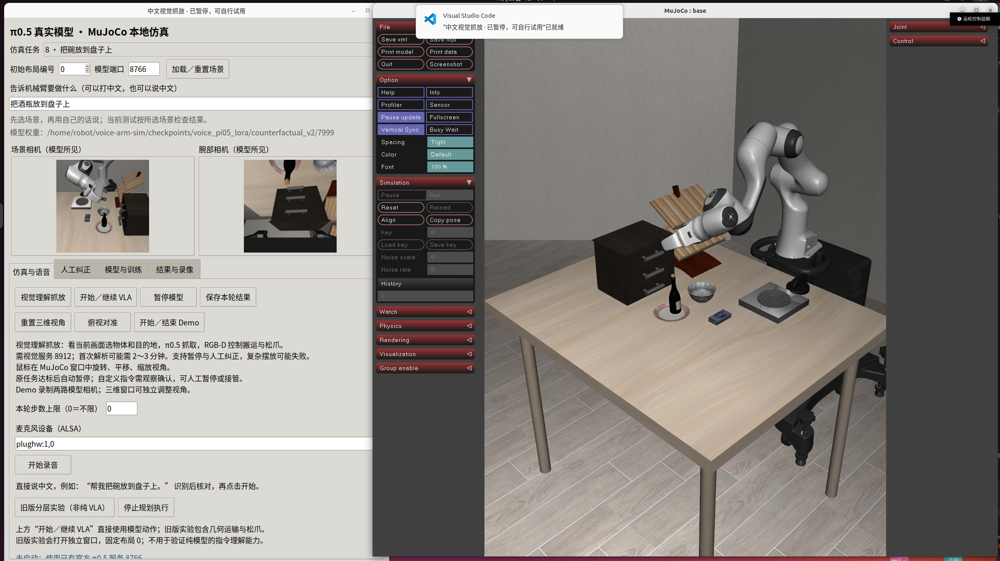

# 中文视觉抓放：2026-10-25 实测

本轮把“看当前图像决定抓谁、放哪里”接入现有中文 MuJoCo 工作台。酒瓶进碗、酒瓶上盘、碗上盘已有实际物理执行证据；木架放置、把酒瓶从碗里取出仍失败。**不是任意家庭物品抓放已经解决，也不是新训练出的通用 VLA。**

## 实际使用的链路

中文文字／语音 → Qwen3-VL 根据当前 RGB 图像输出源物体框、目的地框、in/on 关系和英文指令 → RGB-D 估计位置 → π0.5 预测连续动作完成抓取 → RGB-D／OSC 搬运、松爪和撤手。

- 当前仿真机械臂是 LIBERO 的 Panda；运行原生 MuJoCo 窗口和中文 Tk 面板。
- 视觉模型：`Qwen/Qwen3-VL-4B-Instruct`，revision `ebb281ec70b05090aa6165b016eac8ec08e71b17`。
- 语音模型：Qwen3-ASR-0.6B，revision `5eb144179a02acc5e5ba31e748d22b0cf3e303b0`。
- 动作模型：**之前已微调的** `counterfactual_v2/7999`，并非此次从官方基座直接零样本运行。checkpoint manifest SHA256：`4a848d78570a687f8a2e839e505c997b0434ffbd47944feba29cfb426aec329c`。本轮没有训练或变更权重。旧训练与权重恢复见[此前报告](../language-guidance/DISTILLATION.md#恢复公开模型)。
- openpi `15a9616a00943ada6c20a0f158e3adb39df2ccac`，LIBERO `f78abd68ee283de9f9be3c8f7e2a9ad60246e95c`。模型窗口10步，抓取阶段执行前5步后重新观察。种子为42。
- 本入口是**视觉语言模型＋学习抓取＋几何放置**的混合控制。它复用通用阶段控制程序，但源物体、目的地由模型和当前图片选择，没有“中文句子→固定世界坐标”的表。
- 控制器不读取场景物体名称、真实位置或评分器结果；使用渲染 RGB、深度、相机标定和机器人状态。独立评分器可读取仿真真值，但不把结果交给策略。没有用 weld 把物体吸到夹爪。
- 服务 metadata 的 `prompt_masking` 是支持的探测功能名称；本入口没有发送 `_probe_mask_prompt`，没有关闭语言输入。

参考了用户提供的开源项目架构与视觉指令流程，源码结论及访问限制见[开源项目调研](开源项目调研.md)。未部署这些仓库的整套系统，未把作者的视频当作本项目验收结果。

## 实测与录像

同一场景是 `libero_goal` 任务8。默认布局0；布局1另行注明。表中运动完成与任务成功分开记录，`motion_completed_unscored` 本身不代表语义任务成功。

| 中文指令／情形 | 控制步 | 本次证据与结论 |
| --- | ---: | --- |
| 酒瓶放进碗里，布局0 | 257 | [录像](runs/bottle-bowl-init0-v2/demo.mp4)、[末帧](runs/bottle-bowl-init0-v2/final.png)、[独立近似评分 true](runs/bottle-bowl-init0-v2/evaluation.json)；视觉复核酒瓶在碗里，夹爪已撤离 |
| 酒瓶放进碗里，布局1 | 240 | [录像](runs/bottle-bowl-init1/demo.mp4)、[末帧](runs/bottle-bowl-init1/final.png)、[近似评分 true](runs/bottle-bowl-init1/evaluation.json)；目标位置随图像变化 |
| 酒瓶放到盘子上，布局0 | 284 | [录像](runs/bottle-plate-init0/demo.mp4)、[末帧](runs/bottle-plate-init0/final.png)；人工视觉复核瓶在盘上，**未实现独立自动评分** |
| 碗放到盘子上，布局0 | 246 | [录像](runs/bowl-plate-init0/demo.mp4)、[末帧](runs/bowl-plate-init0/final.png)、[官方 LIBERO 判据 true](runs/bowl-plate-init0/evaluation.json) |
| 酒瓶放到木架上，首次 | 189 | [失败录像](runs/bottle-rack-init0/demo.mp4)、[结果](runs/bottle-rack-init0/result.json)；运输未收敛，抬升高度不足以让瓶底避开架子 |
| 酒瓶放到木架上，提高通用避让高度后 | 225 | [失败录像](runs/bottle-rack-init0-v2/demo.mp4)、[评分 false](runs/bottle-rack-init0-v2/evaluation.json)、[末帧](runs/bottle-rack-init0-v2/final.png)；运动走完但瓶落在架下桌面，**未解决斜面放置** |
| 同一场景先入碗，再从碗里取到空桌面 | 257＋180 | [入碗](runs/sequence/0/demo.mp4)后**没有重置场景**；[取出失败录像](runs/sequence/1/demo.mp4)、[结果](runs/sequence/1/result.json)。VLM 正确选酒瓶和空桌面，π0.5 在180步内没形成抬起候选，仍在碗内 |
| 中文面板实际点击“视觉理解抓放”，酒瓶上盘 | 274 | [最终面板截图](panel-windows.png)、[按钮执行记录](panel-verification.json)、[录像](runs/panel-v3/demo.mp4)；人工视觉复核瓶在盘上，自动评分为空 |
| 中文合成录音“帮我把酒瓶放进碗里面” | 257 | [语音识别记录](voice-receipt.json)、[录像](runs/voice-bottle-bowl/demo.mp4)、[近似评分 true](runs/voice-bottle-bowl/evaluation.json)；ASR／翻译2.31秒，后续视觉与运动26.24秒。**真人麦克风未验收** |



这些是开发阶段的小样本运行，布局0也已多次用于调试；不是独立盲测成功率，不能外推到陌生家庭物品。酒瓶入碗的近似评分要求接触、XY中心距离小于3厘米、Z中心差小于8厘米，并且连续5个实际控制步没有夹爪接触。它仍需视觉核对，不能严格证明几何容纳。连续操作第一段是在已稳定的末态重复评分5次，**不是5个新的控制步**，该差异已写入其 `evaluation.json`。

每段原始结果在 `runs/<案例>/result.json`，模型原始输出和输入图像分别为 `model.json`／`input.png`，实际动作、末端位置及夹爪状态为 `trace.json`。录像是每控制步一帧、20fps，**没有录入模型等待的墙钟时间**；不能用播放时长衡量实际运行速度。

## 本轮修复和未解决问题

1. 8912 服务并发请求会返回429。早期零步失败保留在 [bottle-bowl-init0](runs/bottle-bowl-init0/result.json)；后续按顺序执行。没有把这条删除或算成功。
2. 面板的256像素观察和512像素定位图像混入同一录屏，触发尺寸错误。现在定位继续用512，录屏始终使用同尺寸观察。[首次面板失败](runs/panel/result.json)、[修复后执行](runs/panel-v2/result.json)均保留；新增尺寸回归测试。
3. 新入口最初漏掉逐控制步的 `viewer.sync()`，导致相机预览更新而三维窗口不跟随。已经补齐，并通过最终面板真实点击执行和回归测试验证。
4. 搬运高度现在按放置面高度和抓取时末端高度推导，避免只抬高末端却让瓶底碰架。**这只修复避让高度，不足以解决木架的倾斜支撑、姿态及防滑。**
5. 从容器里重新抓取仍失败。当前证据能定位到“中文／视觉任务已解析，抓取阶段没形成有效抬起候选”，不能据此单独断言训练步数不足或数据问题。应先针对容器遮挡、夹爪可达性和抓取姿态建立独立测试，再考虑补示范或换抓取方法。
6. 夹爪开度＋末端抬升只是抓取候选，不是可靠的物体身份／接触验证；运输时假设物体的水平抓取偏移基本不变。深度连通域也假设物体相对分离。接触、重叠、遮挡、斜面、不可达物体、动态扰动和任意形状都没有被普遍解决。
7. 本入口没有完整碰撞规划、多轮任务规划或通用自主恢复；失败会保留录像和原因，用户可暂停、人工接管。现有纠错与训练页仍保留，但本轮未用这些新执行记录自动训练。

抓取最多180步，每个几何移动阶段最多80步，松爪15步、稳定观察30步；限额触发会明确报错，**不记成功**。面板“本轮步数上限＝0”属于原来的纯 VLA 入口，不会取消本混合技能的分阶段失败检测。取出测试的180步停止是真实的阶段超时，而非已经成功抓住后被无声截断；是否更长预算能成功还没有证据，不能靠加步数宣称已修复。

## 自己在面板里试

当前已打开的“中文视觉抓放 · 已暂停，可自行试用”窗口是新版。先点“加载／重置场景”恢复待抓物体；在中文框写一句抓放指令，再点 **“视觉理解抓放”**。录音按钮先把语音填入中文框，核对后再点这个按钮。可先试“把酒瓶放进碗里”或“把碗放到盘子上”。

“开始／继续 VLA”仍是旧的纯模型动作模式，和新入口含义不同。MuJoCo 窗口可左键旋转、右键平移、滚轮缩放；“暂停模型”中断后续动作，可切人工纠正。网络推理可能仍在后台完成，暂停后不会继续发送动作。不要同时启动多个8912任务。

## 复现命令与服务

依赖环境沿用本项目的[安装说明](../../vla/README.md)。下面假定官方基础模型、Qwen模型及以前 V2 权重已按说明恢复到本机；本提交不重新上传第三方基础模型。已有服务时直接复用，**不要重复启动或终止别的 GPU 作业**。

```bash
cd /home/robot/voice-arm-sim
# 终端1：语音和放置前的目标重定位，8911
rtk proxy .venv-models/bin/python -u model_service.py
# 终端2：看图解析任务，8912。当前 GPU 紧张，因此单独跑 CPU。
rtk proxy env CUDA_VISIBLE_DEVICES='' OMP_NUM_THREADS=8 MKL_NUM_THREADS=8 OPENBLAS_NUM_THREADS=8 \
  .venv-models/bin/python -u model_service.py --device cpu --vision-only --port 8912
# 终端3：之前训练的 V2 动作模型，8766
rtk proxy .venv-vla/bin/python -u -m vla.serve \
  --checkpoint checkpoints/voice_pi05_lora/counterfactual_v2/7999 --port 8766
```

分别检查8911、8912的 `/health` 返回 `ready: true`。CPU首次解析曾约159秒，后续约18～20秒；会受负载影响。8912仅视觉，语音请求应发8911；不要将服务 `ready` 当作运动能力已经验收。

```bash
# 输出必须是新目录，避免覆盖旧证据。
rtk proxy env MUJOCO_GL=egl .venv-vla-sim/bin/python -u -m vla.semantic_grasp \
  --prompt '把碗放到盘子上' --initial-state 0 --score bowl-on-plate \
  --output runs/my-visual-test-01

# 原生中文面板：启动后加载场景并点击“视觉理解抓放”
rtk proxy env DISPLAY=:0 MUJOCO_GL=glfw __NV_PRIME_RENDER_OFFLOAD=1 __GLX_VENDOR_LIBRARY_NAME=nvidia \
  .venv-vla-sim/bin/python -u -m vla.run --suite libero_goal --task-id 8 --initial-state 0 \
  --port 8766 --panel --viewer --prompt '把酒瓶放进碗里' --output runs/my-visual-panel-01
```

`--score bottle-in-bowl` 是近似独立评分；`--score bowl-on-plate` 使用原任务的官方判据；`--score bottle-on-rack` 为架子独立评分。本次架子评分失败。没有评分或没有匹配评分器的任意新指令必须人工复核，不套用碗上盘判据。

## 检查与备份范围

```bash
rtk proxy env MUJOCO_GL=egl .venv-vla-sim/bin/python -m pytest \
  tests/test_semantic.py tests/test_vla_workbench.py tests/test_vla_voice.py tests/test_hybrid.py -q
# 46 passed, 13 subtests passed
rtk proxy .venv-vla/bin/ruff check model_service.py vla/semantic.py vla/semantic_grasp.py \
  vla/workbench.py vla/panel.py tests/test_semantic.py tests/test_vla_workbench.py
# All checks passed
```

定向检查覆盖结构化任务验证、无固定物体词表、RGB-D几何、暂停不发动作、网络等待取消、输出防覆盖、面板复用场景、纠错指令更新、录屏尺寸和逐步窗口刷新。另完成 `py_compile` 及 `git diff --check`。独立审查代理因本机账户不支持其配置模型而未启动；本轮为本地代码审查及上述实测，没有冒称独立审查通过。

本目录备份实际输入／末帧／重定位图像、原始模型输出、结果、动作轨迹、评分和原始视频，成功失败均保留。逐文件来源及SHA256见 `source-artifact-manifest.json`；较大的深度点云和每次完整动作预测保留在原始 `runs/semantic-20261025/`，该清单标出未归档项，**不把它们说成已上传**。`panel_acceptance_v3.py`、`takeout_acceptance.py`、`voice_acceptance.py` 是本次验收脚本，包含固定测试输出和桌面尺寸，重复运行时需使用新的输出目录。

最终代码／演示的远端恢复验证记录见 `backup-verification.json`（验证完成后生成）。以前的 V2 模型权重与恢复记录在[旧训练报告](../language-guidance/DISTILLATION.md)，本轮只新增代码和评测，没有新 checkpoint。新增能力在 `voice-arm-sim` 仓库，不在旧 `.pi05-handson` 或桌面的历史仿真目录。
