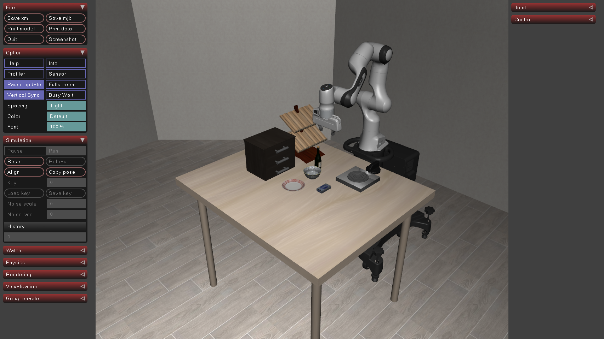
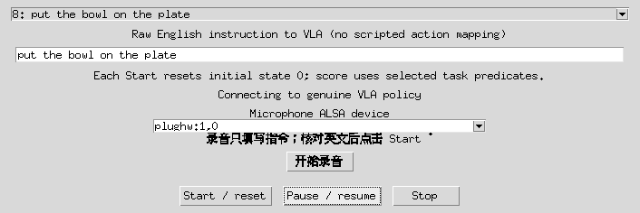

# π0.5 实际模型执行记录 · 2026-10-24

这次把双相机 RGB、8维机械臂状态、原始英文指令直接交给官方预训练 π0.5，执行模型返回的7维连续动作。除官方初始化的10步静置外，没有按物体名调用手写抓放轨迹。本轮没有训练或微调。

[三任务 Demo](demo.mp4)依次展示语音放碗、开抽屉、奶酪入篮。左边是外部相机，右边是腕部相机。每控制步一帧、10fps，未删除中间控制步；视频播放时间不等于计算机执行耗时。Demo 无语音音轨，中文输入来源与识别结果见[语音记录](voice-language-smoke.json)。

| 实际执行 | 套件 / 任务 / 初态 | 控制步 | 推理次数 | 墙钟秒 | 结果 |
| --- | --- | ---: | ---: | ---: | --- |
| [碗放盘上](vla-bowl-plate/paired_cameras.mp4) | goal / 8 / 0 | 81 | 17 | 9.33 | success |
| [打开中间抽屉](vla-drawer/paired_cameras.mp4) | goal / 0 / 0 | 115 | 23 | 5.01 | success |
| [奶酪放篮里](vla-cream-cheese/paired_cameras.mp4) | object / 1 / 0 | 126 | 26 | 5.90 | success |
| [放碗另一初态](vla-bowl-plate-init1/paired_cameras.mp4) | goal / 8 / 1 | 73 | 15 | 4.01 | success |
| [中文合成语音→放碗](vla-voice-bowl/paired_cameras.mp4) | goal / 8 / 0 | 74 | 15 | 4.08 | success |

这5次是预定的集成检查，涉及3个任务定义，没有任务执行异常，也没有失败任务被从这张表删除。success 指 **LIBERO 所选任务的原始判据**，可能在完全松爪和撤离之前触发，不证明完整收尾、安全性或开放场景成功率。当前代码在判据触发时结束，不能把停止当作模型自动规划出了下一任务。

## 权重、输入与语言检查

- 官方权重 `gs://openpi-assets/checkpoints/pi05_libero`，16对象共12,439,085,481字节，官方 CRC32C 全部通过，SHA256见[清单](checkpoint-manifest.json)。权重不提交 Git。
- 固定 openpi `15a9616a00943ada6c20a0f158e3adb39df2ccac`，LIBERO `f78abd68ee283de9f9be3c8f7e2a9ad60246e95c`，见[源码身份](source-snapshot.json)。
- Python3.11.15；策略 JAX0.5.3 / Flax0.10.2；仿真 MuJoCo3.2.3 / robosuite1.4.1；[策略环境](policy-environment.json)、[仿真环境](sim-environment.json)。RTX5090D，策略约8.8GiB显存。
- 观察按官方约定旋转180°、缩放补边到224×224；state = 位置3 + 轴角3 + 夹爪2。每次返回10×7，执行前5步后重新观察；seed7，策略服务 RNG 从0开始并随请求推进。初态数组、逐次预测、实际执行动作和耗时均保留在每个任务目录。
- [受控语言探针](language-probe/report.json)：固定同一观察和噪声42，相同指令重复得到完全相同输出；改成“碗放炉子”或“开中间抽屉”后动作最大绝对差分别0.1534、0.3658。这证明动作受语言影响，不能证明这两句都完成了任务。
- 中文合成音频“把碗放到盘子上。”经实际 Qwen ASR 得到原句，经 Qwen 翻译为 `Put the bowl on the plate.`，随后直接输入策略完成上述74步。没有真人麦克风验收；Piper测试音色许可未确认，因此不分发音频或音色权重。

## 原生窗口与问题复盘





[原生交互记录](native-ui-check.json)：暂停前后调用数0→0；恢复后调用增加到4，再次暂停4→4；Stop 保存 stopped、16控制步。暂停期间实际鼠标拖动能转动视角。另一次原生完整执行77步通过任务判据；这些交互测试不计入上面的5次预定检查。当前窗口转动只影响观察者自由相机，不改变策略输入相机。

| 遇到的问题 | 原因和处理 |
| --- | --- |
| 官方大权重下载中断/短读 | 固定GCS对象generation，分段恢复，检查206范围和长度，组装后再核官方CRC32C及SHA256；不接受不完整权重。 |
| Qwen翻译请求500 | 当前多模态模板需要system内容为带类型的消息节点；改为text节点后，中文识别→英文翻译实际通过。没有改写识别结果兜底。 |
| PyTorch读取官方LIBERO初态失败 | 新版默认安全加载限制与旧numpy序列化不兼容；仅对固定源码内部官方初态显式weights_only=False，拒绝目录外路径。 |
| 机械臂绿色重影 | 原生viewer同时显示彩色碰撞网格和外观网格；按robosuite相机设置隐藏group0、显示group1。只改显示，物理模型不变。 |
| 桌面默认llvmpipe | GLX实际报告软件渲染；用NVIDIA PRIME环境变量启动后确认硬件OpenGL。它是渲染选择问题，与上述碰撞网格重影分别处理。 |
| 暂停时关闭窗口需退出 | 暂停循环同步viewer并检测is_running；关窗/停止保留结果，不等待重新开始。 |

## 复现和范围

安装与原生面板、模型服务命令见[启动说明](../../vla/README.md)。运行同一组任务：

```bash
cd /home/robot/voice-arm-sim
rtk proxy .venv-vla/bin/python -u -m vla.serve
# 另一个终端；每个输出目录必须是新的
rtk proxy .venv-vla-sim/bin/python -u -m vla.run --suite libero_goal --task-id 8 --initial-state 0 --output runs/recheck-bowl
rtk proxy .venv-vla-sim/bin/python -u -m vla.run --suite libero_goal --task-id 0 --initial-state 0 --output runs/recheck-drawer
rtk proxy .venv-vla-sim/bin/python -u -m vla.run --suite libero_object --task-id 1 --initial-state 0 --output runs/recheck-cheese
rtk proxy .venv-vla-sim/bin/python -u -m vla.probe_language --output runs/recheck-language
```

服务RNG会随请求前进，因此只复现单个命令不保证逐动作数值和步数完全相同；初态、权重、源码、参数、原动作数组都已保存。更换指令不更换原任务判据，自定义任务需另建正确评分。

还没解决：任意香蕉/蓝莓和家庭布局、从盘子取出香蕉的新VLA任务、连续多轮任务、失败恢复、自动在线学习、廉价机械臂适配和真机迁移。它们需要新的任务/数据与独立验收。之前水果几何程序被保留为对照，不混入这份模型结果。

备份核验：[独立 GitHub 恢复比对记录](backup-capability.json)，能力提交 `a55438d` 的228个跟踪文件逐个 SHA256 与 Git tree 均一致。
