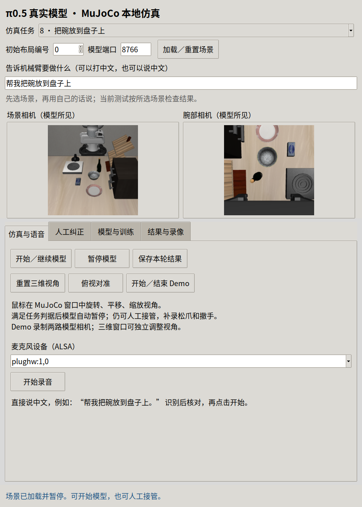

# 中文指令入口验收

任务菜单不再显示英文任务句子；112个中文标签覆盖当前固定 LIBERO 源码的130个任务条目。标签只供显示，动作由真实 π0.5 生成。

面板输入 **帮我把碗放到盘子上**，后台真实本地 Qwen 服务翻译为 `Please put the bowl on the plate.`，官方预训练 `pi05_libero` 在 MuJoCo 执行81个控制步、17次预测，所选任务判据为真。原话保留在输入框及场景 `user_instruction` 中，英文保留在内部 `task` 中。翻译失败不启动旧指令。

原始数据身份、模型身份和初态哈希见 [JSON](chinese-command.json)。本轮通过20项定向测试及 Ruff；没有重新训练，也没有本轮真人麦克风验收。所选场景的成功判据与用户自定义文字独立，不能据此声称任意家庭指令或未知物品操作成功。
