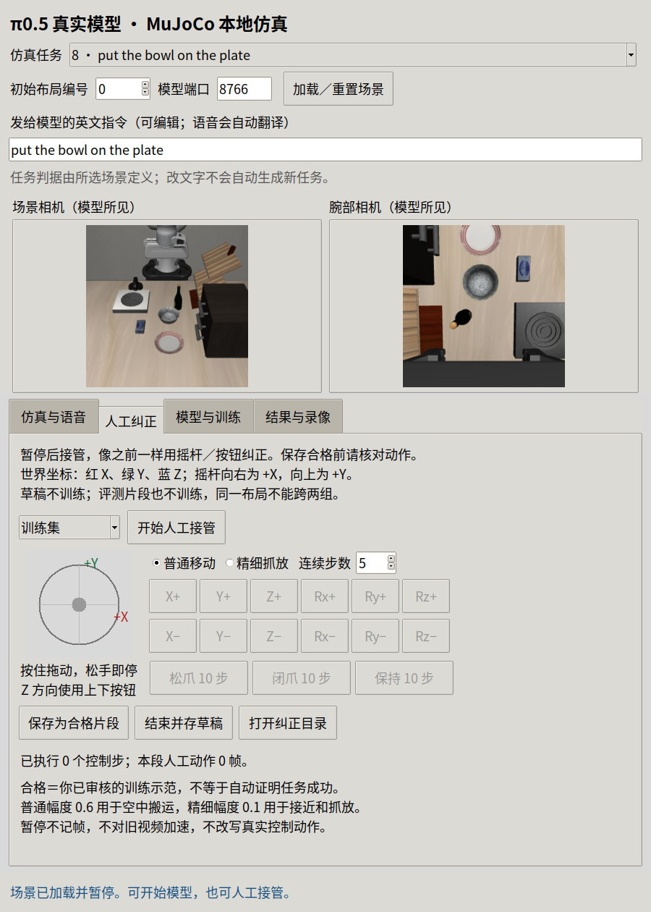
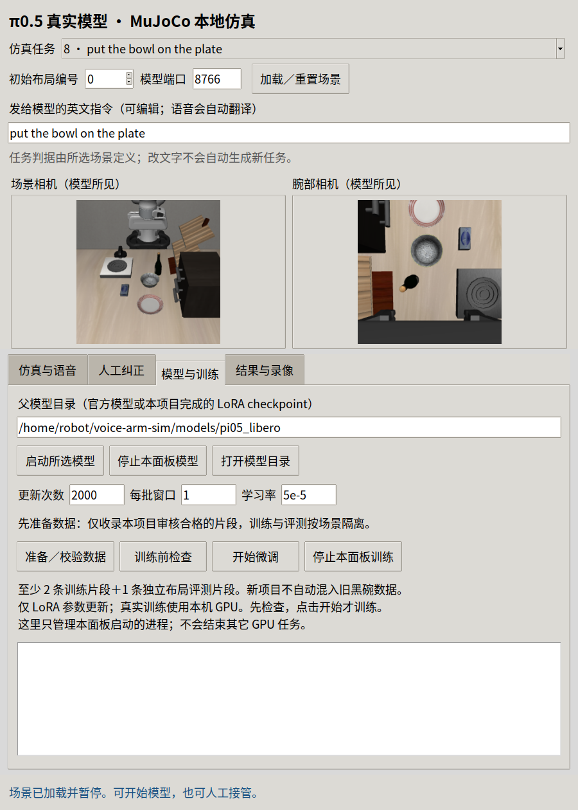

# 中文仿真、人工纠正与训练工作台

2026-10-24，Ubuntu 原生桌面 2560×1440。使用 Noto 中文字体，四页签完整显示；场景相机与腕部相机保持可见。

复用来源：旧 `.pi05-handson/scripts/manual_joystick.py` 的按住移动、松手停止、失焦停止逻辑；本项目增加方向标识、调整说明换行。纠正数据、训练器和窗口在新项目中独立实现，未导入或修改旧黑碗数据。

实测原生窗口加载 LIBERO goal 任务8、初态0 → 人工接管 → 实际执行10个上抬动作 → 等待1秒，记录仍为10帧 → 存草稿 → 交还官方 π0.5 模型。模型继续80个控制步、16次预测，原任务判据为 true。该结果只证明这一次接管闭环工作，不证明任意任务成功率或完整松爪撤手质量。每帧保存执行前观察与实际动作，执行后状态独立记录。

15项定向测试与 Ruff 通过，包含逐帧篡改拒绝、同布局跨训练／留出拒绝、草稿排除、动作窗口不跨片段、最新指令传递与清理异常后的资源关闭。CPU 训练前检查使用隔离的合成契约样本，官方转换输出10×32。合成样本没有进入用户纠正目录，也没有用于 GPU 训练。

训练页连接真实官方 JAX LoRA 训练器；本轮没有启动新训练或产出新 LoRA 权重，未实测新 checkpoint 服务、真人麦克风及训练过程中按停止的退出行为。已持有的外部策略／语音服务保持运行。关闭面板只向本面板创建的训练／模型进程发送退出信号；训练时请等待正常完成再关闭。

结构化结果、源码哈希与限制：[workbench-check.json](workbench-check.json)。使用和数据选择说明见 [vla/README.md](../../vla/README.md#中文工作台人工纠正和微调)。原始人工草稿、模型权重和本地环境未作为演示数据公开。
